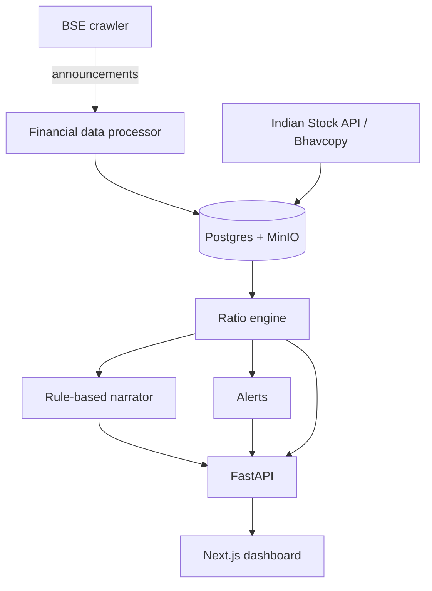

# HalalLens

> **See your investments through a halal lens.** Read-only Shariah-compliance screening for BSE-listed Indian equities, with a rule-based "Explain Why" narrator and compliance-flip alerts.

[](https://github.com/hamza-aziz-ai/HalalLens/actions/workflows/ci.yml)
[](LICENSE)

**Status: pilot.** Billing runs through Razorpay and the screen is a *configured, AAOIFI-inspired* financial screen, not a fatwa or a verified full AAOIFI assessment. Read [How the screen decides](#how-the-screen-decides) and [Known limitations](#known-limitations) before relying on a verdict.

---

## What it does

| Area                   | What exists today                                                                                                                                                                                                                                                                                   |
|------------------------|-----------------------------------------------------------------------------------------------------------------------------------------------------------------------------------------------------------------------------------------------------------------------------------------------------|
| **Screening**          | `ratio_engine/` computes five ratios per filing and returns one verdict: `compliant`, `non-compliant` or `insufficient-data`.                                                                                                                                                                       |
| **Explain-Why**        | Rule-based by default. An optional LLM narrator (`NARRATOR_MODE=llm`) is used only for conclusive verdicts and only if its text passes a best-effort consistency check; the badge and ratio table always show the engine's verdict. Unknown results are always narrated by the rule-based narrator. |
| **Alerts**             | File-backed watchlists and a compliance-flip engine; email delivery through SMTP. `/alerts/check` (paid) reads the stored verdict of the newest filing and checks only the caller's watchlist; the file store needs a single API worker (see [Known limitations](#known-limitations)).              |
| **Filings ingestion**  | BSE announcements crawler, PDF capture in MinIO, Camelot tables plus XBRL/JSON parsing, Indian Stock API and Bhavcopy market data.                                                                                                                                                                  |
| **API + UI**           | FastAPI service (`/docs` lists every route) and a Next.js 16 static-export dashboard.                                                                                                                                                                                                               |
| **Accounts + billing** | Email/password and Google SSO, hashed opaque session tokens, Razorpay orders with idempotent webhooks, trials.                                                                                                                                                                                      |

Not built: GCC or mutual-fund coverage, NSE crawling (`crawler/nse_ann.py` exists but nothing calls it), RAG/vLLM serving, SES/Celery alert delivery, and the Flutter app's Dart source (`halallens-mobile/` is a platform scaffold with no `lib/`, so it cannot build).

---

## How the screen decides

For each filing the engine computes five ratios and compares each against a configured cap:

| Ratio                             | Cap | Basis                                                           |
|-----------------------------------|-----|-----------------------------------------------------------------|
| Total debt / market cap           | 30% | AAOIFI SS21 (uses *total* debt, not only interest-bearing)      |
| Cash and equivalents / market cap | 30% | AAOIFI SS21 (uses all cash, not only interest-bearing deposits) |
| Non-permissible income / revenue  | 5%  | AAOIFI SS21                                                     |
| Accounts receivable / market cap  | 67% | **not backed by SS21**, kept as configured                      |
| Liquid assets / market cap        | 49% | **not backed by SS21**, kept as configured                      |

Verdict rule (`ratio_engine/engine.py`, one place; nothing else re-derives it):

- **`non-compliant`**: any ratio computed from valid inputs fails. A failure is conclusive even if other inputs are missing.
- **`compliant`**: all five ratios were computed from valid inputs and all passed. Prohibited income needs its base figure, interest income and dividend income to all be known (an explicit `0` counts); an unknown part is never assumed zero.
- **`insufficient-data`**: anything else. This is *not* a failure. `is_compliant` is `null` in the API and the UI shows "Insufficient data".

`needs-review` is an API-level overlay for filings with open data-quality issues; it is also stored and returned with `is_compliant = null`.

Arithmetic is exact (Decimal, no tolerance): 0.30000000000000004 over a 0.30 cap fails. Inputs must be finite numbers within float range; booleans, NaN/inf, negatives and underflowing strings are treated as unknown.

---

## Architecture



Deeper maps: [`docs/ARCHITECTURE.md`](docs/ARCHITECTURE.md), [`docs/FLOW.md`](docs/FLOW.md), [`Documentations/dependency-map.md`](Documentations/dependency-map.md).

---

## Local development

```bash
git clone https://github.com/hamza-aziz-ai/HalalLens.git
cd HalalLens
cp .env.example .env          # then fill in the values; never commit .env
pipenv install --dev          # Python 3.14
```

**Database.** Postgres and MinIO are external. For a fresh database apply `database/schema.sql`; for an existing one apply the dated files in `database/migrations/` in order. `scripts/run_migrations.sh` does both and records applied files in `schema_migrations`.

```bash
createdb halallens_dev
DATABASE_URL=postgresql://user@localhost/halallens_dev bash scripts/run_migrations.sh
```

`20260728_security_hardening.sql` clears `user_sessions` (tokens are now stored as SHA-256 digests), so everyone signs in again once; it also adds the unique `(provider, event_id)` index on `payment_events`.

**API and UI.**

```bash
pipenv run uvicorn api.app:app --reload --port 8001      # http://localhost:8001/docs
cd ui && npm install && npm run dev                        # http://localhost:3000
```

Set `NEXT_PUBLIC_HALAL_API_BASE_URL` (in `ui/.env.local`) to the API origin. It is baked in at build time.

**Tests.**

```bash
pipenv run pytest                                   # backend; same command CI runs
cd ui && npm test && npm run lint && npm run build  # frontend
```

Tests must not need live Postgres, MinIO, an LLM or vendor APIs.

### Narrator

`NARRATOR_MODE` defaults to `rule_based` (the only path whose consistency with the verdict is guaranteed). With `NARRATOR_MODE=llm` (plus `LLM_ENDPOINT`, `LLM_MODEL`, optional `LLM_API_KEY`, `LLM_TEMPERATURE`, `LLM_MAX_TOKENS`, `LLM_TIMEOUT`) the model is asked only about `compliant` / `non-compliant` results. Its text is shown only if it repeats the engine's verdict in a `screen_verdict` field and its summary, verdict and bullets pass a keyword check; otherwise, on any LLM error, and for `insufficient-data`, the rule-based narrator is used, and the label shown is always the engine's. **This is best-effort, not a guarantee:** a paraphrase the check does not know can still contradict the verdict, so the UI marks LLM text as AI-generated. `tools/preflight.py` requires the LLM endpoint to be reachable in `llm` mode. Set `LLM_MAX_TOKENS=0` and/or `LLM_TIMEOUT=0` to let the server decide limits (useful for reasoning-heavy models).

### Google SSO (optional)

Create a Google "Web application" OAuth client, then set `GOOGLE_CLIENT_ID`, `GOOGLE_CLIENT_SECRET`, `GOOGLE_REDIRECT_URI` (`<api>/auth/google/callback`; behind Caddy in production `https://<domain>/api/auth/google/callback`) and `FRONTEND_BASE_URL`. The token is returned in the URL **fragment** (`/login#token=...`), never the query string, and the redirect must match `FRONTEND_BASE_URL` or the `halallens://` scheme.

---

## API and security model

`/docs` (FastAPI OpenAPI) is the route reference. Every route has a tier:

| Tier              | Who                                    | Routes                                                                                                                                            |
|-------------------|----------------------------------------|---------------------------------------------------------------------------------------------------------------------------------------------------|
| **Public**        | anyone (rate limited per IP)           | `/health`, `/health/billing` (reconciler heartbeat: status and age only), `/halal-score`, `/filings/recent`, `POST /feedback`, `GET /feedback/status/{token}`, `/billing/plans`, `/auth/*`, `/webhooks/razorpay`, `/client-logs`, cached `/filings/{symbol}` |
| **Authenticated** | any signed-in user with a verified email | `/auth/me`, `/auth/logout`, `/auth/google/link/*`, `/market-data/{symbol}`, `/billing/trial`, `/billing/entitlement`, `/billing/razorpay/*`, `/billing/cancel`              |
| **Paid**          | active or trialing subscription        | `/narrate`, `/watchlist*`, `/alerts/check`, `/filings/{symbol}/history`, `/filings/{symbol}?refresh=true`                                         |
| **Admin**         | `is_admin` on a verified account; granted to `ADMIN_EMAILS` only when that mailbox is proven | `GET/PATCH /feedback`, `/feedback/{id}/events`, `/governance/*`, `/ingestion/stats`, `/ops/metrics`                                               |

`/halal-score` and `/narrate` return `is_compliant` (`true`, `false` or `null`) and `screen_verdict` (`compliant`, `non-compliant`, `insufficient-data`). **`null` is not `false`.**

Boundaries worth knowing:

- Accounts are email-first (D-020): sign-up emails a link and the password is chosen there; `POST /auth/password/forgot` sends a set-password link that also verifies the email and signs out every device. Every session belongs to a verified email; an address in `ADMIN_EMAILS` becomes admin only after its mailbox is proven (sign-up link, reset link or Google). Google sign-in matches accounts by Google ID only, never by email, and needs `email_verified=true`; a different Google account is linked only from the account page, after re-entering the password, and only the session that started the link can finish it (D-021). Every Google flow is single-use, expires in 10 minutes and is bound to the browser that started it by a short-lived HttpOnly cookie, which needs the UI and API on one origin (`/api`, the production setup). Links carry the single-use token in the URL fragment; only its SHA-256 digest is stored.
- Governance overrides rewrite the inputs behind *every* user's verdict for a filing, so they are admin-only. Reviewer identity comes from the session, never the request body.
- Watchlists are keyed off the session; the `user_id` path parameter is ignored.
- `/alerts/check` takes only a symbol. The verdict is the stored evaluation of the symbol's newest filing, used only when it is conclusive and has no open quality issues; a caller-supplied `is_compliant` is ignored, and only the caller's own entries are checked or moved. Lookup failures return 503.
- `/market-data` requires a session because a cache miss spends vendor quota.
- Session tokens are SHA-256 digests; passwords are PBKDF2-HMAC-SHA256 at 600k iterations (older hashes are re-hashed on next login).
- Razorpay webhooks are idempotent through the unique `(provider, event_id)` index on `payment_events`.

Rate limits (per worker process, see the caveat):

```env
RATE_LIMIT_ENABLED=true
RATE_LIMIT_LOGIN_PER_MINUTE=10       # per IP
RATE_LIMIT_REGISTER_PER_HOUR=5       # per IP, also throttles trial farming
RATE_LIMIT_PUBLIC_PER_MINUTE=60      # per IP, /halal-score
RATE_LIMIT_METERED_PER_MINUTE=30     # per user, /narrate + /market-data
RATE_LIMIT_WRITE_PER_HOUR=30         # per IP, /feedback + /client-logs
TRUST_PROXY_HEADERS=false            # true only behind a proxy you control
ALLOWED_ORIGIN_REGEX=                # opt-in; matched with fullmatch, not a prefix
```

> The limiter keeps counters in process memory, so `uvicorn --workers N` multiplies every limit by `N` and restarts reset them. Acceptable for the pilot; move `SlidingWindowRateLimiter` (`api/security.py`) to Redis before scaling out.

---

## Docker pilot

`docker-compose.yml` runs `preflight`, `api` (port 8001), `ui` (port 3001), and the `ingestion` and `evaluation` schedulers against an **external** Postgres and MinIO. `docker-compose-prod.yml` adds Caddy for TLS and a bundled Postgres, stores filing PDFs in an external S3-compatible bucket (Cloudflare R2 by default; MinIO no longer publishes free images), and serves everything on one domain (`HALAL_APP_DOMAIN`): the dashboard at `/` and the API under `/api/` (Swagger at `/api/docs`). In production, register `https://<domain>/api/auth/google/callback` with Google and `https://<domain>/api/webhooks/razorpay` with Razorpay. Caddy either serves the domain itself with Let's Encrypt (`CADDY_MODE=tls`) or sits behind a Cloudflare Tunnel with no open web ports (`CADDY_MODE=tunnel`, used for `halallens.in`); see `README_ops.md`.

```bash
cp .env.example .env     # set POSTGRES_*, MINIO_*, INDIAN_API_*, NEXT_PUBLIC_HALAL_API_BASE_URL, ...
docker compose up --build
```

Published images: every release publishes `halallens-api` and `halallens-ui` for linux/amd64 and linux/arm64 to GHCR (`ghcr.io/hamza-aziz-ai/halallens-api`, `...-ui`) and, when configured, Docker Hub, tagged `vX.Y.Z` (and `latest` for the newest release). See `.github/workflows/publish-images.yml`.

Operations (logs, metrics, backups, secret rotation, troubleshooting): [`README_ops.md`](README_ops.md). Ingestion CLI: [`README_ingestion.md`](README_ingestion.md).

> **Before deploying a new verdict engine** to a database that already holds evaluations, read [`docs/ROLLBACK.md`](docs/ROLLBACK.md) and [`docs/HANDOVER.md`](docs/HANDOVER.md): stored evaluations keep their old verdicts until they are recomputed.

---

## CI, automation and releases

- **CI** (`.github/workflows/ci.yml`): `backend` (pytest), `ui` (lint, jest, build) and `secrets` (gitleaks over full history). Actions are pinned by SHA; the token is read-only.
- **`main` is protected by a ruleset:** pull request required (squash merge), the three checks above must pass; the repository owner can bypass for hotfixes.
- **Dependabot** runs monthly and groups its PRs, titled `build(deps): ...`. Per ecosystem (GitHub Actions, UI, Python): one minor/patch group (UI splits dev and runtime), one group for majors, and one for security updates, which Dependabot raises separately as advisories appear. Auto-merge covers GitHub Actions and UI dev minor/patch, plus patch-level security updates for Actions and the UI; UI runtime minors, Python and every major wait for a human. Majors of the UI framework stack (Next, React, TypeScript, eslint, jest, Testing Library, Tailwind) and `@types/node` are ignored until their planned upgrade (types follow the Node 24 runtime).
- **Docs-only PRs auto-merge** (`docs-automerge.yml`): when every changed file is Markdown under `docs/` or `Documentations/`, a README or `CHANGELOG.md`, the PR squash-merges once `backend`, `ui` and `secrets` pass. `AGENTS.md` and `CLAUDE.md` stay manual. The rule runs from `main` (`pull_request_target`), so a PR cannot change the rule that judges it.
- **Releases (automatic):** release-please opens a release PR from Conventional Commit titles on `main` (`feat:` bumps the minor version, `fix:` the patch; `build:`, `ci:` and `docs:` do not release). With `RELEASE_PLEASE_TOKEN` in the `release` environment (usable only from `main`), CI runs on that PR and it auto-merges when green; the merge tags `vX.Y.Z`, updates `CHANGELOG.md` and publishes the GitHub Release. A release is a tag and notes only: nothing is deployed. Squash-merge PRs so each change appears once in the changelog. Without the secret the release PR must be merged by hand.
- **No GitHub Pages:** the static Pages build (`nextjs.yml`) was removed on 2026-10-28 because it was never wired to an API. **The UI ships only with the Docker deployment** (`ui` service), built with `NEXT_PUBLIC_HALAL_API_BASE_URL`.
- No container registry or API deployment workflow exists yet.

---

## Known limitations

- **Methodology.** The receivables (67%) and liquid-assets (49%) market-cap gates are not backed by AAOIFI SS21 but are required for `compliant`. Debt and cash use total balances, not only interest-bearing ones.
- **Income inputs are weak evidence.** The PDF extractor's prohibited-income regex also matches "interest income"; the vendor maps "Other, Net" to the base; vendor interest is net; governance overrides carry no declared contract. Interest and dividend figures are rarely extracted, so many filings screen as `insufficient-data`.
- **Stored evaluations can be stale.** Evaluations computed by an older engine keep their verdicts until recomputed: run `python -m jobs.backfill_evaluations --recompute --report dry_run.csv` (dry run), then `--recompute --report write_run.csv --write` (a new report name each run; an existing file is refused). It uses the current stored inputs and stored market caps, never calls the vendor, and `--write` requires the report.
- **Watchlists live in Postgres** (`watchlist_entries`, D-019). Re-adding a symbol keeps its baseline; a flip is detected with conditional updates, so concurrent `/alerts/check` calls send at most one alert per flip. Run one worker anyway (`API_WORKERS=1`, the compose default) while the rate limiter is per-process. Alerts fire only when a user calls `/alerts/check` (no scheduled job does), and email is best-effort.
- `etl/financial_data_processor.py::_detect_scale` uses substring checks that can mis-scale values; `liquid_assets` is mapped from "current assets".
- `market_data/indian_api.py::_get_stock_payload` is cached for the process lifetime, including failures.
- `ui/lib/api.ts::callAnalysis` always calls the paid `/narrate`, so free users' manual analysis errors after `/halal-score` succeeds.
- The rate limiter is per process (see above).

---

## Repository structure

```
api/              FastAPI app (api/app.py) and security helpers (api/security.py)
alerts/           watchlist storage, flip engine, email notifier
config/           environment helpers and logging config
crawler/          BSE announcements fetcher (NSE fetcher exists, unused)
database/         schema.sql, database manager, dated migrations/
Documentations/   charter PDF and planning notes
docs/             handover, decisions, architecture, threat and failure notes
etl/              financial data processor and MinIO client
halallens-mobile/ Flutter platform scaffold (no Dart source)
jobs/             ingestion, evaluation and scheduler entry points
market_data/      Indian Stock API and Bhavcopy resolution
monitoring/       ops notifier and metrics
narrator/         rule-based narrator and optional best-effort LLM narrator
ratio_engine/     ratio math, verdict, summary, amount coercion
scripts/          run_migrations.sh and helpers
tests/            pytest suite
tools/            preflight, probes, metrics inspector, load test
ui/               Next.js 16 dashboard (static export) and jest tests
```

## Contributing

Use Conventional Commit titles (`fix:`, `feat:`, `docs:`, `ci:`), keep one logical change per PR, and never commit secrets, keys or `.env` files. New environment variables go in `.env.example`; schema changes need a dated file in `database/migrations/` *and* an update to `database/schema.sql`. Changes to ratio logic need a row in the golden table in `tests/test_ratio_engine.py`.

## License

[MIT](LICENSE)
