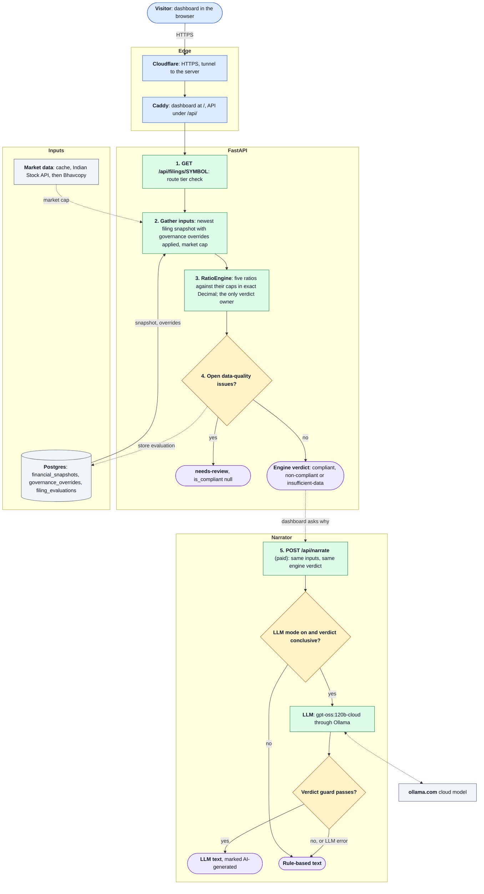
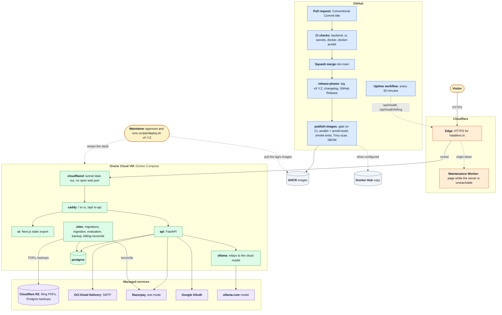

# HalalLens

Status: pilot. Information and education only, not investment advice, and not a fatwa or a verified full AAOIFI assessment.

HalalLens screens BSE-listed Indian equities against an AAOIFI-inspired Shariah screen built from their filings. For each filing it computes five ratios (total debt, cash, accounts receivable and liquid assets against market cap, and non-permissible income against revenue) and returns one verdict: `compliant`, `non-compliant` or `insufficient-data` when an input is unknown, never a guess. An explain-why narrator says in plain English which ratios decided it, watchlists send compliance-flip alerts by email, and paid plans (Explain-Why, watchlists, alerts, filing history) are sold through Razorpay. The public site is https://halallens.in.

## System Design

What happens to one screening request. Solid arrows are the path every request takes; dotted arrows are optional, cached or written on the side.



Key: blue is the way in, green the steps the API runs, amber a decision, purple an outcome the visitor sees, grey data and outside services. Read top to bottom; the numbers match the notes below.

1. The dashboard asks for a symbol's screen. Cloudflare carries it over HTTPS through a tunnel to Caddy, which sends `/api/` to FastAPI; the API checks the route's tier (public for a cached filing, paid for a refresh). Per-IP rate limits apply to computing and account routes such as `/halal-score`, `/narrate` and sign-in, not to filing lookups.
2. The API loads the newest filing's figures from `financial_snapshots`, with any admin governance override applied, and the market cap from its cache, the Indian Stock API or, as a fallback, the BSE Bhavcopy.
3. `RatioEngine` computes the five ratios and compares each with its cap (30% debt, 30% cash, 5% non-permissible income, 67% receivables, 49% liquid assets) in exact Decimal. It is the only place a verdict is decided; an unknown input gives `insufficient-data`, never an assumed zero.
4. If the filing has any open data-quality issue, the shared publication overlay returns `needs-review` with `is_compliant = null`; otherwise it returns the engine's verdict. The API and the scheduled jobs save the result in `filing_evaluations` through the same path, so a stored or cached result is never conclusive while an issue is open (D-027).
5. Explain-why is a separate paid call. In LLM mode, and only for a conclusive verdict, `gpt-oss:120b-cloud` (through Ollama) drafts the text, which is shown only if it repeats the engine's verdict and passes a best-effort guard; otherwise, or on any error, the rule-based narrator writes it. The verdict shown never comes from the model.

Method detail and the caps' sources: [Screening method](docs/guides/SCREENING.md). Modules and request functions: [docs/ARCHITECTURE.md](docs/ARCHITECTURE.md), [docs/FLOW.md](docs/FLOW.md).

## Solution Architecture

How the code becomes the live site at https://halallens.in. Right: build and release on GitHub. Middle: the image registries, the maintainer's deploy and the Cloudflare edge. Left: the server, with the managed services it uses below it.



Key: blue is GitHub, grey the image registries, amber a person, orange Cloudflare, green the containers on the server, purple managed services. Solid arrows run on every change or request; dotted arrows are manual, conditional or periodic. Start at the pull request (top right), then follow the visitor from Cloudflare into the server.

1. **Build and release.** Every change arrives as a pull request with a Conventional Commit title. The `backend`, `ui`, `secrets`, `docker` and `docker-arm64` checks must pass before a squash merge into `main`; release-please then tags `vX.Y.Z`, updates `CHANGELOG.md` and publishes the GitHub Release.
2. **Images.** The published release starts `publish-images.yml`: it waits for CI on the released commit, builds the API and UI natively for amd64 and arm64, smoke-tests them (including the Caddy routing), scans them with Trivy and pushes them with an SBOM and provenance to GHCR and, when configured, Docker Hub. A published version is never overwritten.
3. **Deploy (Continuous Delivery, not Continuous Deployment).** Nothing reaches production on its own. The maintainer approves a release and runs `scripts/deploy.sh vX.Y.Z` on the Oracle Cloud VM, which checks out the tag, pulls its images, starts the stack and smoke-tests through Caddy; rollback is the same command with the previous tag ([docs/ROLLBACK.md](docs/ROLLBACK.md)).
4. **On the server.** The visitor reaches Cloudflare over HTTPS; `cloudflared` holds an outbound tunnel, so the VM has no open web port. Caddy serves the dashboard at `/` and the API under `/api/`. Beside the API run Postgres, the migrations, ingestion, evaluation, backup and billing-reconcile jobs, and an Ollama relay to the cloud model. Filing PDFs and database backups go to Cloudflare R2, email to OCI Email Delivery, payments to Razorpay in test mode, sign-in to Google OAuth.
5. **While down.** If Caddy, the tunnel or the VM is unreachable, a Cloudflare Worker shows the HalalLens maintenance page instead of Cloudflare's error; `/api/*` never passes through it. A GitHub workflow probes `/api/health` and `/api/health/billing` every 30 minutes and opens an issue when either fails.

The same images run on one machine with `docker-compose.yml` against an external Postgres and MinIO ([Docker pilot](docs/guides/DOCKER.md)). Server operations, backups and secret rotation: [README_ops.md](README_ops.md).

## Quick start

Run the API, the dashboard and the schedulers with Docker Compose against your own Postgres and MinIO (apply `database/schema.sql` first, see [Local development](docs/guides/SETUP.md)):

```bash
cp .env.example .env     # set POSTGRES_*, MINIO_*, INDIAN_API_*, NEXT_PUBLIC_HALAL_API_BASE_URL, ...
docker compose up --build
```

Open http://localhost:3001 for the dashboard and http://localhost:8001/docs for the API. To run from source instead, follow [Local development](docs/guides/SETUP.md).

## Documentation

| Guide                                               | What it covers                                                                                                   |
|-----------------------------------------------------|------------------------------------------------------------------------------------------------------------------|
| [Screening method](docs/guides/SCREENING.md)        | What exists today, the five ratios and their caps, the verdict rule, exact arithmetic, the full limitations list |
| [Local development](docs/guides/SETUP.md)           | Clone and install, the database and migrations, running the API and UI, tests, the narrator, Google SSO          |
| [API and security model](docs/guides/API.md)        | Route tiers, account and Google sign-in boundaries, governance and watchlist rules, rate limits                  |
| [Docker pilot](docs/guides/DOCKER.md)               | The development and production Compose stacks, published images, links to operations                             |
| [CI, automation and releases](docs/guides/CI-CD.md) | CI checks, the `main` ruleset, Dependabot, docs auto-merge, release-please                                       |
| [Repository structure](docs/guides/STRUCTURE.md)    | What each top-level folder holds, and the module map                                                             |
| [Operations runbook](README_ops.md)                 | Environment, deployment, logs, metrics, backups, secret rotation, troubleshooting                                |
| [Ingestion CLI](README_ingestion.md)                | Crawling BSE announcements, parsing filings, backfills and recomputes                                            |

The `docs/` folder is the engineering record, kept in the "Defend What You Ship" layout. Start with [docs/HANDOVER.md](docs/HANDOVER.md) (where things stand) and [docs/CONSTRAINTS.md](docs/CONSTRAINTS.md) (rules for changes); it also holds the decision log ([DECISIONS](docs/DECISIONS.md)), rejected options ([ALTERNATIVES](docs/ALTERNATIVES.md)), [ARCHITECTURE](docs/ARCHITECTURE.md), the request [FLOW](docs/FLOW.md), data structures ([DATA](docs/DATA.md)), [THREAT](docs/THREAT.md) and [FAILURE](docs/FAILURE.md) maps, the [TESTING](docs/TESTING.md) plan, the [ROLLBACK](docs/ROLLBACK.md) plan, open [ASSUMPTIONS](docs/ASSUMPTIONS.md) and the [DEPENDENCIES](docs/DEPENDENCIES.md) log. Operations and ingestion live in [README_ops.md](README_ops.md) and [README_ingestion.md](README_ingestion.md); the charter and planning notes in [Documentations/](Documentations/).

## Known limitations

- **No filings in production yet.** BSE answers 403 to the production server for announcements, so production ingestion stores no filings; a permitted data source (written permission or a licensed feed) is the maintainer's decision, and the blocking is not worked around.
- **Inputs are weak evidence.** Inputs the mappers cannot establish stay missing (D-028), so the prohibited-income base comes only from a governance override (which carries no declared contract) and many filings screen as `insufficient-data`; extraction does not read XBRL contexts or know which PDF column is the filing's period. The receivables (67%) and liquid-assets (49%) gates are not backed by AAOIFI SS21 but are required for `compliant`, and evaluations stored by an older engine keep their verdicts until recomputed.
- **Single-host pilot.** Everything runs on one VM with one API worker; the rate limiter keeps its counters in process memory, so more workers multiply every limit and a restart resets them. Move it to Redis before scaling out.

The full list is in [Screening method](docs/guides/SCREENING.md#known-limitations).

## Contributing

Use Conventional Commit titles (`fix:`, `feat:`, `docs:`, `ci:`), keep one logical change per PR, and never commit secrets, keys or `.env` files. New environment variables go in `.env.example`; schema changes need a dated file in `database/migrations/` *and* an update to `database/schema.sql`. Changes to ratio logic need a row in the golden table in `tests/test_ratio_engine.py`. Update this README and the guides in `docs/guides/` in the same PR as the behaviour they describe.

## License

[MIT](LICENSE)
