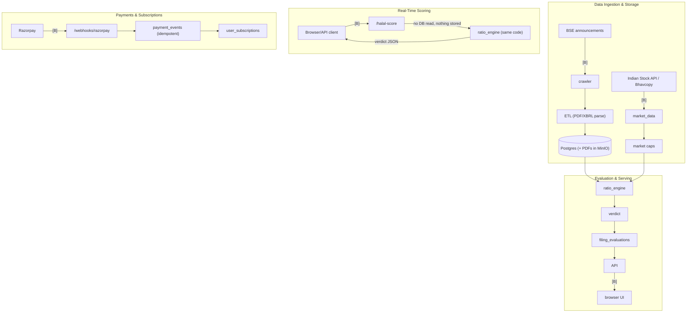

# ARCHITECTURE

One page. Trust boundaries are marked **[B]**. Deeper docs: [FLOW.md](FLOW.md), [DATA.md](DATA.md), [THREAT.md](THREAT.md), [FAILURE.md](FAILURE.md).

## Modules and what they own

| Module                          | Owns                                                                                                                                    |
|---------------------------------|-----------------------------------------------------------------------------------------------------------------------------------------|
| `api/app.py`, `api/security.py` | HTTP routes (public / authenticated / paid / admin), auth, billing, rate limiting                                                       |
| `ratio_engine/`                 | The five ratios and the **only** verdict derivation (`engine.py`), `summary.py`, `amounts.py`                                           |
| `narrator/`                     | Explain-why text: rule-based by default; optional LLM text for conclusive verdicts behind a best-effort guard (`narrator/explainer.py`) |
| `alerts/`                       | File-backed watchlists, flip detection, SMTP notifier                                                                                   |
| `crawler/`, `etl/`, `jobs/`     | BSE announcements -> PDF/XBRL parsing -> Postgres + MinIO; schedulers                                                                   |
| `market_data/`                  | Indian Stock API and Bhavcopy market caps                                                                                               |
| `database/`                     | `schema.sql`, `database_manager.py`, dated migrations                                                                                   |
| `ui/`                           | Next.js 14 static export, calls the API from the browser                                                                                |

## Data flow

## Trust boundaries [B]

1. **Public HTTP** (`/halal-score`, `/filings/recent`, auth, feedback, webhook): anyone; validated by Pydantic models (`extra="forbid"`, no booleans or underflowing strings as amounts) and rate-limited per IP.
2. **Authenticated/paid/admin HTTP**: opaque session token (SHA-256 digest stored), tier checked per route.
3. **Razorpay webhook**: signature-verified, idempotent on `(provider, event_id)`.
4. **Filings and PDFs from BSE**: untrusted documents parsed by Camelot/pdfminer/lxml.
5. **Vendor and market APIs**: untrusted numbers; every value passes `coerce_amount` and the engine's own validation.
6. **Operators**: admin routes (governance overrides, feedback triage) change inputs behind every user's verdict.

## Verdict ownership

`RatioEngine.evaluate` returns `RatioEvaluation.verdict` (`compliant` / `non-compliant` / `insufficient-data`). `is_compliant` is derived. The API adds `needs-review` when data-quality issues are open. No other module may re-derive a verdict.

## Deployment

Docker Compose (`api`, `ui`, `ingestion`, `evaluation`, `preflight`, optional Caddy) against external or bundled Postgres/MinIO. Repository workflows deploy GitHub Pages only; there is no API deployment workflow (external triggers unverified).
