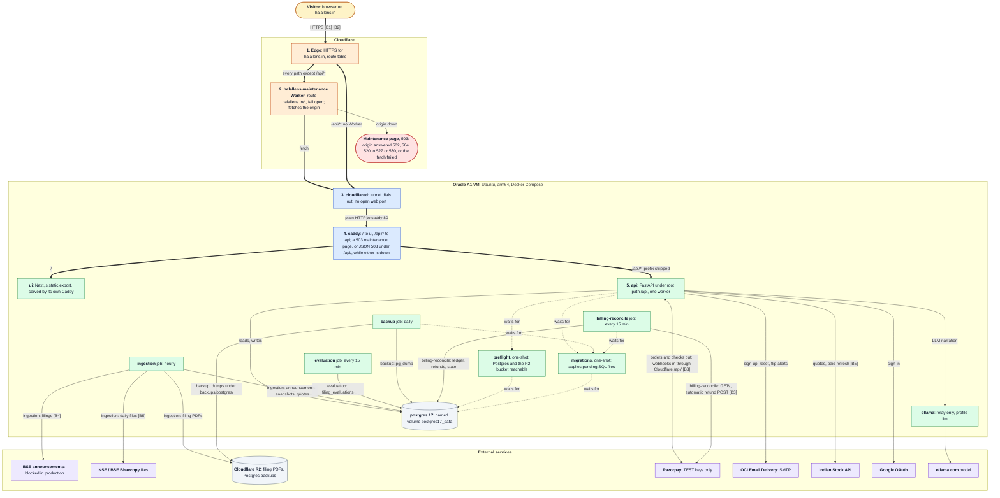
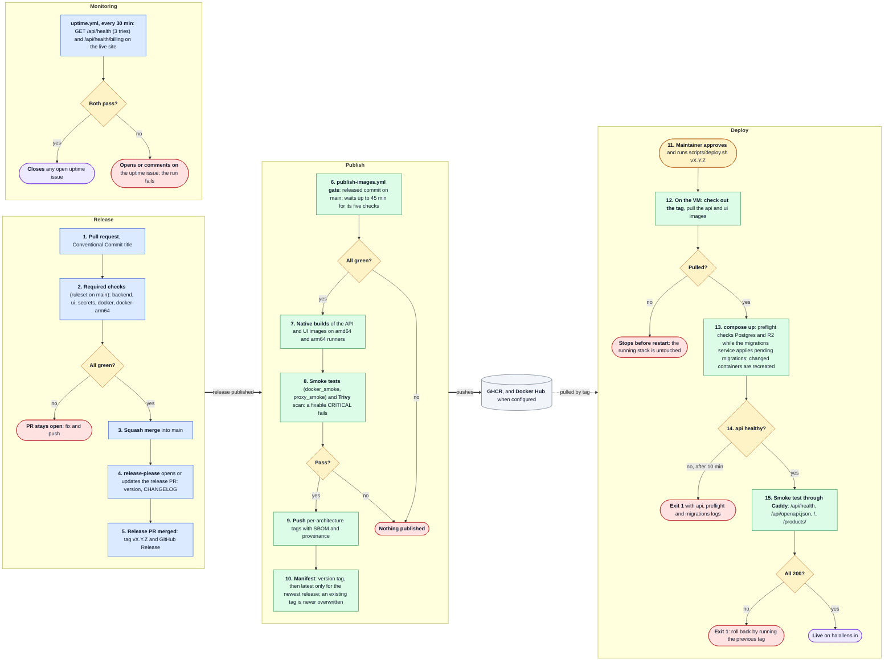
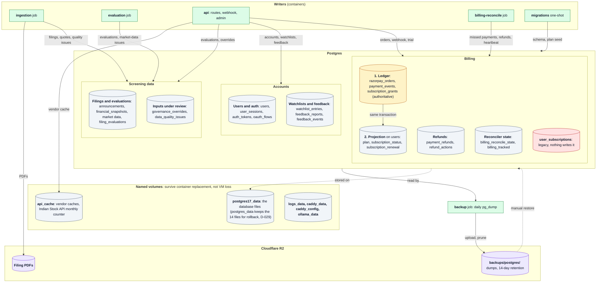

# ARCHITECTURE

One page. Trust boundaries are marked **[B]**. Deeper docs: [FLOW.md](FLOW.md), [DATA.md](DATA.md), [THREAT.md](THREAT.md), [FAILURE.md](FAILURE.md). The verdict path of a single request is drawn in the [README](../README.md); request functions are in [FLOW.md](FLOW.md).

## Modules and what they own

| Module                          | Owns                                                                                                                                    |
|---------------------------------|-----------------------------------------------------------------------------------------------------------------------------------------|
| `api/app.py`, `api/security.py` | HTTP routes (public / authenticated / paid / admin), auth, billing, rate limiting                                                       |
| `api/billing.py`, `api/razorpay_client.py` | Paid access derived from `subscription_grants` (D-024); Razorpay REST access shared by the API and the reconciler                  |
| `jobs/reconcile_payments.py`    | Payment reconciler (D-025): settles payments the webhook missed, applies refunds made elsewhere, automatic refunds (TEST keys only)    |
| `ratio_engine/`                 | The five ratios and the **only** verdict derivation (`engine.py`), `summary.py`, `amounts.py`                                           |
| `evaluation/`                   | Shared publication overlay (`quality.py`, D-027): ratio-anomaly detector and the policy that masks the engine's pair as `needs-review` while any quality issue is open |
| `narrator/`                     | Explain-why text: rule-based by default; optional LLM text for conclusive verdicts behind a best-effort guard (`narrator/explainer.py`) |
| `alerts/`                       | Watchlists in Postgres, flip detection, SMTP notifier                                                                                   |
| `crawler/`, `etl/`, `jobs/`     | BSE announcements -> PDF/XBRL parsing -> Postgres + S3-compatible store (R2 in production, MinIO locally); schedulers                   |
| `market_data/`                  | Indian Stock API and Bhavcopy market caps                                                                                               |
| `database/`                     | `schema.sql`, `database_manager.py`, dated migrations                                                                                   |
| `ui/`                           | Next.js 16 static export, calls the API from the browser                                                                                |

## Solution architecture

Three views of the same system: what runs where and talks to what (A1), how a change reaches production and is watched there (A2), and where each kind of data lives and who writes it (A3). Colours mean the same in all three:

- **Amber**: a person or a decision (A1, A2), the authoritative billing ledger (A3).
- **Orange**: Cloudflare.
- **Blue**: the way in (A1), GitHub (A2).
- **Green**: a container or a step that runs code.
- **Grey**: storage.
- **Purple**: an outside service (A1), a good outcome (A2), objects in R2 (A3).
- **Red**: an error outcome, or a legacy table.

### A1. Runtime topology

Key: thick arrows are the visitor's request path; thin solid arrows are calls a container makes while it runs, labelled with what it moves (job edges name the job); dotted arrows are Compose startup dependencies, pointing at what the service waits for. `[Bn]` marks a crossing of trust boundary n in [Trust boundaries](#trust-boundaries-b). Read top to bottom; the numbers follow one request. Not drawn: every job also mails ops alerts through OCI Email Delivery (`monitoring/notifier.py`).

1. Cloudflare terminates HTTPS for `halallens.in`. Paths under `/api/*` (API calls and Razorpay webhooks) have no Worker and go straight to the tunnel.
2. Every other path runs the `halallens-maintenance` Worker (`cloudflare/maintenance-worker.js`). It fetches the origin and returns the origin's answer unless Cloudflare reports the origin unreachable (502, 504, 520 to 527, 530) or the fetch throws; then it answers its own 503 maintenance page. The route fails open: if the Worker errors or the free plan's daily limit runs out, requests go to the origin as if there were no Worker.
3. `cloudflared` (Compose profile `tunnel`) holds an outbound tunnel, so the VM has no open web port; it hands requests to Caddy over plain HTTP inside the Compose network. Caddy binds to `127.0.0.1` on the host in this mode (D-017).
4. `caddy` (`Caddyfile`) sends `/` to `ui` and strips `/api` before proxying to `api`. When `ui` or `api` is down (a deploy), its `handle_errors` block answers 503 with `caddy/maintenance.html`, or a JSON 503 under `/api/`; never a 502, which Cloudflare would replace with its own page.
5. `api` is FastAPI under uvicorn with `--root-path /api` and one worker, because the rate limiter is per-process memory. It is the only container that serves users; the jobs share its image but run their own entrypoints.

| Cloudflare Worker route | Worker                   | Failure mode |
|-------------------------|--------------------------|--------------|
| `halallens.in/*`        | `halallens-maintenance`  | Fail open    |
| `halallens.in/api/*`    | None                     | n/a          |

| Service (`docker-compose-prod.yml`) | Starts after                                                       |
|-------------------------------------|--------------------------------------------------------------------|
| `postgres`                          | nothing; healthy when `pg_isready` passes                          |
| `preflight`, `migrations`           | `postgres` healthy                                                 |
| `api`                               | `preflight` and `migrations` completed successfully                |
| `ui`, `ingestion`, `evaluation`     | `api` healthy                                                      |
| `caddy`                             | `api` and `ui` healthy                                             |
| `cloudflared` (profile `tunnel`)    | `caddy` started                                                    |
| `backup`, `billing-reconcile`       | `migrations` completed successfully                                |
| `ollama` (profile `llm`)            | nothing                                                            |

### A2. Delivery and operations

Key: thick arrows hand one release from stage to stage; the dotted arrow is the maintainer's pull, which happens only when they run the deploy. Inside a stage, read top to bottom; the numbers are the order. Monitoring runs on its own schedule against whatever is live. This is Continuous Delivery, not Continuous Deployment: every release is built, tested, scanned and published automatically, and production changes only when the maintainer runs `scripts/deploy.sh vX.Y.Z` on the VM.

1. Every change is a pull request with a Conventional Commit title (`.github/workflows/ci.yml`).
2. The `main` ruleset requires `backend`, `ui`, `secrets`, `docker` and `docker-arm64`; `docker-arm64` builds on GitHub's arm64 runner because the VM is arm64.
3. `main` takes squash merges only, so the PR title becomes the release note.
4. `release-please.yml` opens or updates one release PR with the next version and the `CHANGELOG.md` entry; `build:`, `ci:` and `docs:` titles do not cut a release.
5. Merging the release PR creates the tag `vX.Y.Z` and the GitHub Release.
6. `publish-images.yml` starts on the published Release. Its gate checks that the tagged commit is on `main` and waits up to 45 minutes for the five checks on that exact commit; anything but success stops it.
7. API and UI images build natively on amd64 and arm64 runners from the released commit.
8. `scripts/docker_smoke.sh` and `scripts/proxy_smoke.sh` test the candidates; Trivy fails the run on a CRITICAL vulnerability that has a fix.
9. Per-architecture tags are pushed with an SBOM and provenance to GHCR and, when `DOCKERHUB_NAMESPACE` and `DOCKERHUB_TOKEN` are set, Docker Hub.
10. The manifest step joins them into `vX.Y.Z` (it refuses to overwrite an existing version) and moves `latest` only for the newest release.
11. The maintainer approves the release and runs `scripts/deploy.sh vX.Y.Z` in the VM checkout that holds `.env`.
12. The script checks out the tag (compose file, `Caddyfile`, migrations) and, because `IMAGE_REPOSITORY` is set, pulls the tag's `api` and `ui` images; without it, it builds on the server instead. A failed pull exits before anything restarts.
13. `docker compose up -d --no-build` reruns `preflight` and the `migrations` service (`scripts/run_migrations.sh`), then recreates the containers whose image or config changed.
14. The script waits up to 10 minutes for `api` to report healthy; otherwise it prints the `api`, `preflight` and `migrations` logs and exits 1.
15. It requests `/api/health`, `/api/openapi.json`, `/` and `/products/` through Caddy; any non-200 exits 1, and rollback is the same script with the previous tag ([ROLLBACK.md](ROLLBACK.md)).

Monitoring: `uptime.yml` runs at minutes 7 and 37 of every hour when the repository variable `UPTIME_URL` is set. `/api/health` gets three tries; `/api/health/billing` must say `ok`, or `disabled` unless `BILLING_EXPECTED` is `true`. A failure opens one issue labelled `uptime` (or comments on the open one) and fails the run; the issue closes when both pass.

Side rules, not drawn:

- **Dependabot** (`dependabot-automerge.yml`): auto-merge for minor and patch updates of GitHub Actions and UI dev dependencies, and patch-level security updates in the `actions-security` and `ui-security` groups; Python packages, UI runtime minors and every major are reviewed by hand.
- **Docs auto-merge** (`docs-automerge.yml`): a non-draft PR from this repository that changes only Markdown under `docs/` or `Documentations/`, a README or `CHANGELOG.md` merges once checks pass; `AGENTS.md` and `CLAUDE.md` stay manual.
- **Release token**: with `RELEASE_PLEASE_TOKEN` the release PR runs CI and auto-merges; without it the default token still opens the PR, but CI does not run on it and it is merged by hand.
- **Retry**: `publish-images.yml` can be run by hand for an existing tag.
- **Docker Hub pages**: `dockerhub-description.yml` copies `docs/dockerhub/*.md` to the repository descriptions on every change to them on `main`.

### A3. Data ownership

Key: green boxes are the containers that write; grey cylinders are Postgres domains and named volumes, purple cylinders objects in R2. Solid arrows write, labelled with what; dotted arrows are where the data physically sits and the manual restore. In billing, **1. Ledger** is the truth and **2. Projection** is a copy of it written in the same locked transaction. Read top to bottom: writers, the database, then where its bytes live. Column-level detail and trade-offs: [DATA.md](DATA.md).

| Domain | Tables | Writers | Readers |
|--------|--------|---------|---------|
| Filings and evaluations | `announcements`, `financial_snapshots`, `market_data_snapshots`, `bhavcopy_quotes`, `indianapi_snapshots`, `filing_evaluations` | ingestion (filings, Bhavcopy market snapshots, evaluations of new filings); evaluation (`filing_evaluations`, market snapshots); api (paid refresh through the Indian Stock API, evaluations, `bhavcopy_quotes` and `indianapi_snapshots` caches) | api (filing, history and alert routes, narration); evaluation (engine inputs) |
| Inputs under review | `governance_overrides`, `data_quality_issues` | api (admin overrides; quality issues); ingestion and evaluation (quality issues, market-data failures) | api and evaluation: overrides win over extracted values for every user; an open issue makes every writer store, and every filing route return, `needs-review` (D-027) |
| Users and auth | `users`, `user_sessions` (SHA-256 digests), `auth_tokens`, `oauth_flows` | api (sign-up, login, reset, Google sign-in) | api, on every authenticated request |
| Billing ledger | `subscription_plans` (seeded by migrations), `razorpay_orders`, `payment_events` (unique `(provider, event_id)`), `subscription_grants` (authoritative, D-024) | api (order, verify, webhook, trial, cancel); billing-reconcile (payments the webhook missed) | api (`api/billing.py` folds the grants); billing-reconcile |
| Access projection | `users.plan`, `users.subscription_status`, `users.subscription_renewal` | Written only with a grant change, in the same per-user locked transaction | api route tiers; an expired projection is refreshed from the grants |
| Refunds (D-025) | `payment_refunds`, `refund_actions` | api (webhook refunds, settles refund actions); billing-reconcile (refunds made elsewhere, automatic refunds with TEST keys only) | billing-reconcile; api |
| Reconciler state (D-025) | `billing_reconcile_state`, `billing_tracked` | billing-reconcile | billing-reconcile; api (`/health/billing` heartbeat) |
| Watchlists (D-019) | `watchlist_entries` | api (paid users, keyed by the session's user id) | api (`/alerts/check`) |
| Feedback | `feedback_reports`, `feedback_events` | api (public create, admin triage) | api (admins; the reporter by tracking token) |
| Legacy | `user_subscriptions` | nothing (pre-ledger, kept for history) | nothing |
| Objects in R2 | Filing PDFs; `backups/postgres/<db>-<timestamp>.dump` | ingestion (PDFs); backup (daily `pg_dump`, deletes dumps older than 14 days after a successful upload) | restore by hand ([README_ops.md](../README_ops.md)) |
| Named volumes | `postgres17_data` (the old `postgres_data` holds the Postgres 14 files until the upgrade retention ends, D-029), `api_cache`, `logs_data`, `caddy_data`, `caddy_config`, `ollama_data` | the container that mounts each | the same container; they survive container replacement, not the loss of the VM |

## Trust boundaries [B]

1. **Public HTTP** (`/halal-score`, `/filings/recent`, auth, feedback, webhook): anyone; validated by Pydantic models (`extra="forbid"`, no booleans or under-flowing strings as amounts) and rate-limited per IP.
2. **Authenticated/paid/admin HTTP**: opaque session token (SHA-256 digest stored), tier checked per route.
3. **Razorpay webhook and API**: the webhook is signature-verified and idempotent on `(provider, event_id)`; a grant needs a captured payment matching the order's amount and currency; refunds apply only to the payment they refund. The reconciler trusts only what it fetches from Razorpay with the account's keys.
4. **Filings and PDFs from BSE**: untrusted documents parsed by Camelot/pdfminer/lxml.
5. **Vendor and market APIs**: untrusted numbers; every value passes `coerce_amount` and the engine's own validation.
6. **Operators**: admin routes (governance overrides, feedback triage) change inputs behind every user's verdict.

## Verdict ownership

`RatioEngine.evaluate` returns `RatioEvaluation.verdict` (`compliant` / `non-compliant` / `insufficient-data`). `is_compliant` is derived. The shared publication overlay (`evaluation/quality.py`, applied by `BSEDatabaseManager.publish_filing_evaluation` for every writer and by `_filing_response` for every filing read) publishes `needs-review` while any data-quality issue is open; it only masks the engine's pair and never derives a verdict from ratios (D-027). No other module may re-derive a verdict.

## Deployment

Docker Compose (`caddy`, `api`, `ui`, `postgres`, `preflight`, `migrations`, `ingestion`, `evaluation`, `backup`, `billing-reconcile`; `cloudflared` with the `tunnel` profile and `ollama` with the `llm` profile) against Postgres and an S3-compatible bucket (MinIO locally, Cloudflare R2 in production for filing PDFs and backups, D-016). Continuous Delivery, not Continuous Deployment: every release is built, tested, scanned and published automatically (`publish-images.yml`), and production changes only when the maintainer approves `scripts/deploy.sh vX.Y.Z` on the VM (pull mode). In front: Cloudflare Tunnel, and the `halallens-maintenance` Worker that shows the maintenance page when the origin is unreachable (`/api/*` bypasses it). The uptime workflow probes `/api/health` and `/api/health/billing`. Views A1 and A2 above draw all of this.
