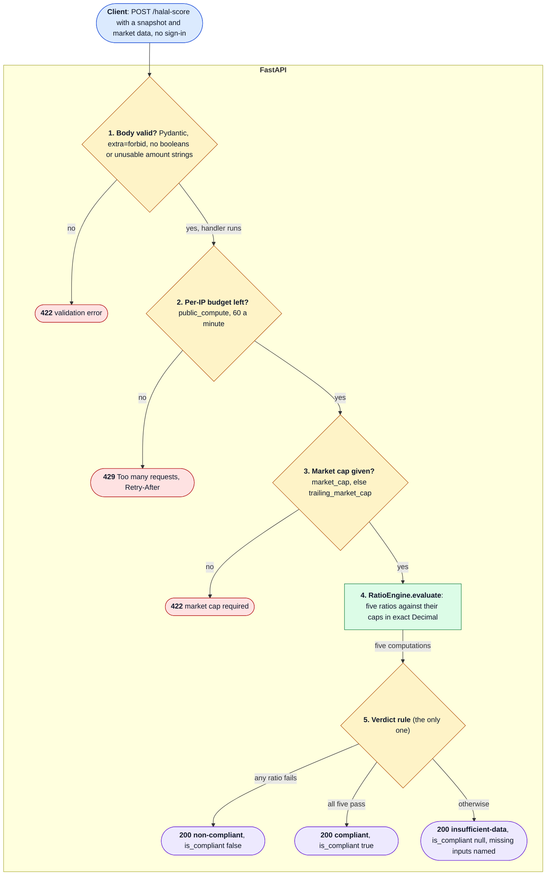
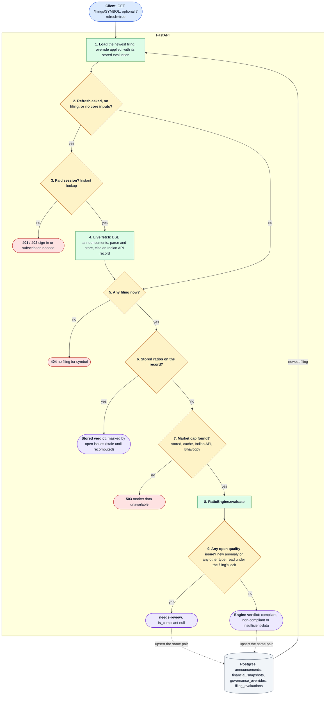
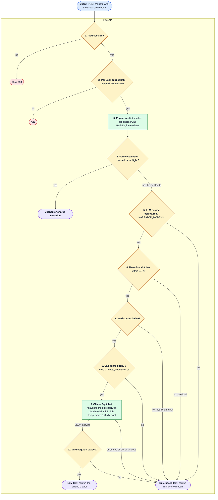
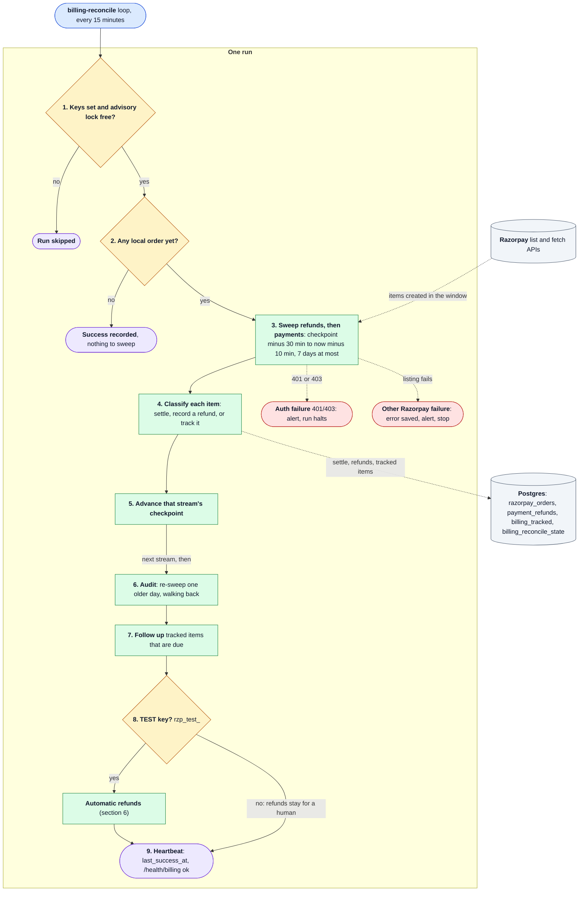
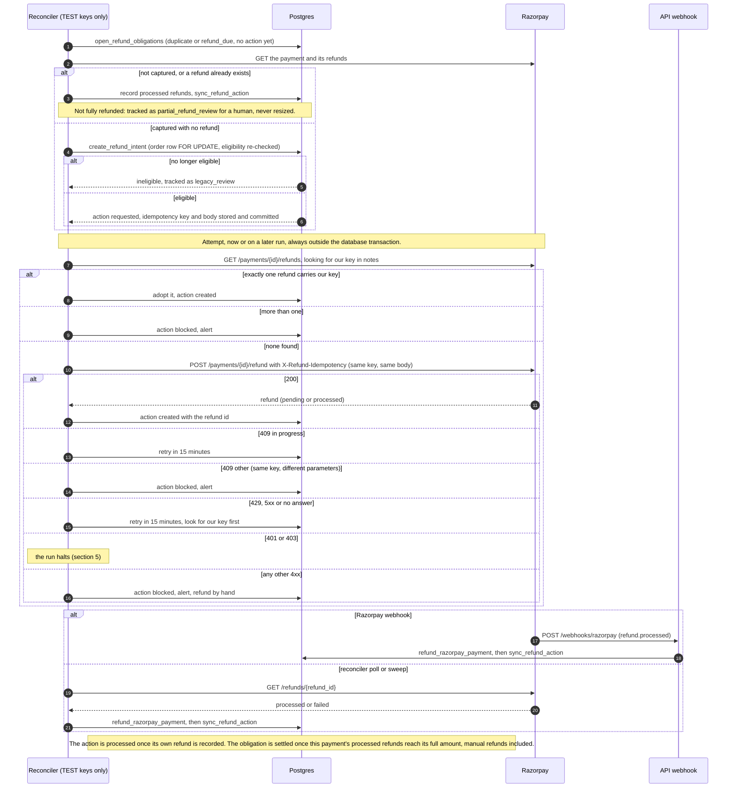
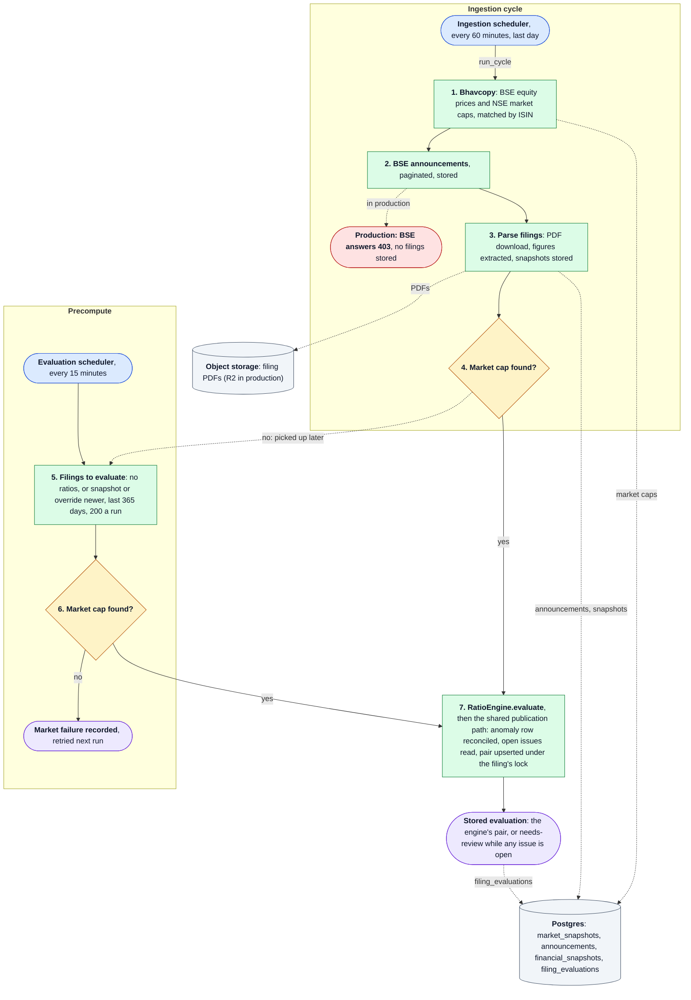
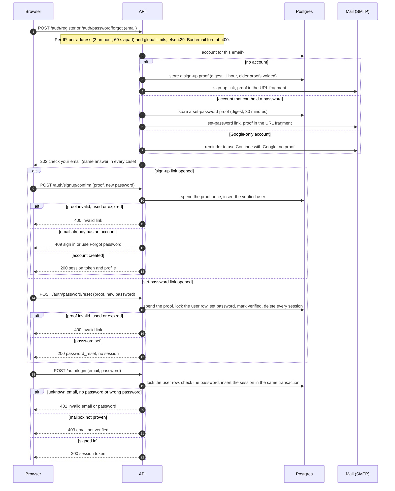
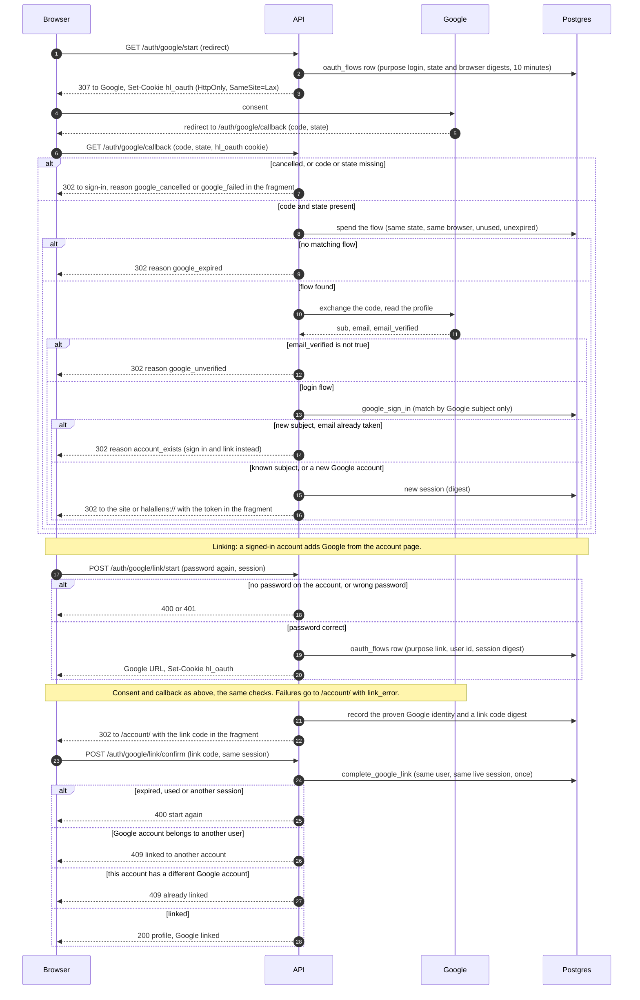
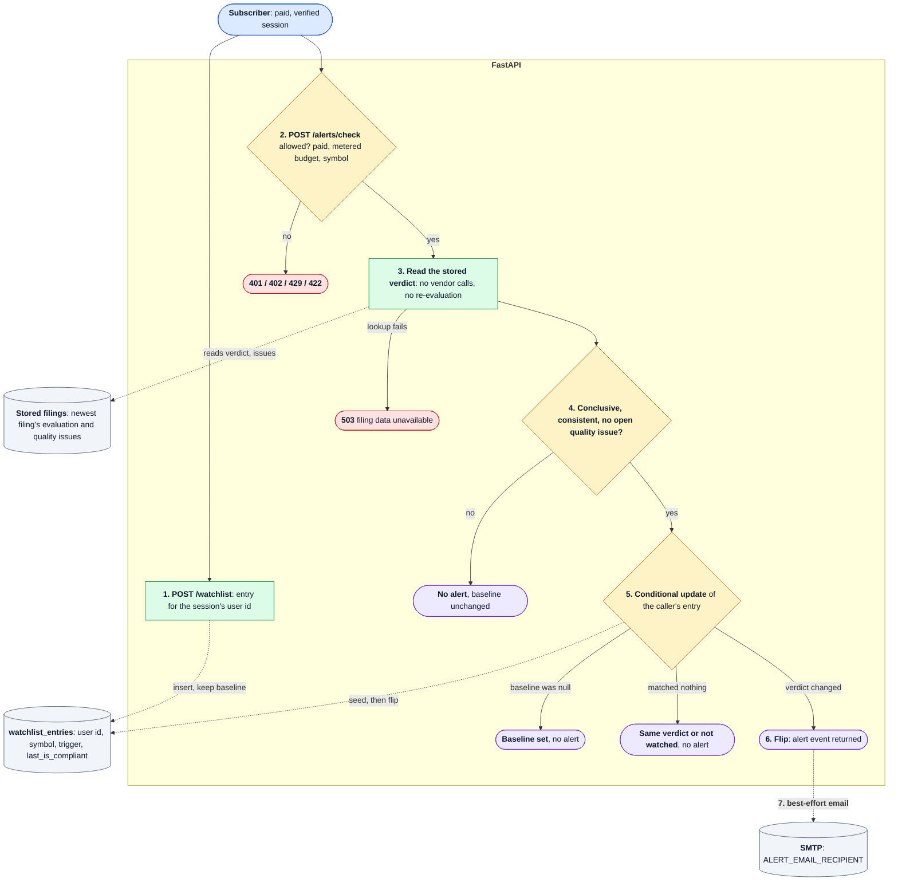

# FLOW: system design

How execution travels through HalalLens, one flow per section: scoring, filings, narration, checkout, reconciliation, refunds, ingestion, email accounts, Google sign-in and alerts. Each section has a diagram, a key, a numbered trace whose numbers match the diagram, and the functions it was checked against. The [README's System Design](../README.md#system-design) is the one-picture overview; [ARCHITECTURE.md](ARCHITECTURE.md) maps the modules.

How to read the diagrams:

- **Flowcharts** read top to bottom. Blue is the way in, green a step the code runs, amber a decision, purple an outcome the caller sees, red an error outcome, grey a data store or an outside service.
- **Arrows**: a solid arrow is the path a request takes; a dotted arrow is a write on the side, a later pickup or an optional call. Arrow labels are the condition or the verb.
- **Sequence diagrams** read top to bottom in time; solid arrows are requests, dashed arrows are answers, and `alt` boxes are the branches. Cookies and URL fragments are data carried on a message, not participants.
- **Numbers** in a node or on an arrow match the numbered trace under the diagram.

Checked against the code on `main` at 4d5d1d9 (2026-10-29). When the code changes, fix the diagram and its trace in the same PR.

## 1. Public score: `POST /halal-score`



Key: blue the caller, green the engine, amber a check, purple a 200 answer, red an error answer. Read top to bottom; nothing is read from or written to the database.

1. FastAPI validates the body against `HalalScoreRequest` before the handler runs. Every model forbids unknown fields, and `_reject_unsupported_amount` refuses JSON booleans and strings such as `"1e-400"` that would coerce to a misleading number (via `coerce_amount`). A bad body is a 422 and does not use up the caller's rate-limit budget.
2. The handler charges the per-IP `public_compute` bucket (`RATE_LIMIT_PUBLIC_PER_MINUTE`, default 60 a minute). The identity is the client address, or the first `X-Forwarded-For` entry only when `TRUST_PROXY_HEADERS` is set. The limiter lives in process memory (one API worker).
3. `_evaluate_request` needs `market_cap` or `trailing_market_cap` (the trailing cap stands in only when the primary is absent or 0); without either it answers 422.
4. `RatioEngine.evaluate` cleans each input (finite, non-boolean, exact `Decimal`) and computes debt, cash, receivables and liquid assets against market cap, and non-permissible income (all of base, interest and dividend income must be known) against revenue. A ratio passes when `numerator <= cap × denominator`, so there is no division and no float tolerance; caps are 30%, 30%, 67%, 49% and 5%.
5. `_aggregate_verdict` is the only place a verdict is derived: any failed ratio gives `non-compliant` (even if other inputs are missing), all five passing gives `compliant`, anything else gives `insufficient-data` with `is_compliant = null` and the reasons in `missing_inputs`. An unknown input is never treated as zero. The response repeats the engine's pair as `screen_verdict` and `is_compliant`.

Sources: `api/app.py::halal_score`, `api/app.py::_evaluate_request`, `api/app.py::_reject_unsupported_amount`, `api/app.py::_enforce_rate_limit`, `api/app.py::_client_identity`, `api/security.py::SlidingWindowRateLimiter`, `ratio_engine/engine.py::RatioEngine.evaluate`, `ratio_engine/engine.py::RatioEngine._aggregate_verdict`, `ratio_engine/models.py::RatioThresholds`.

## 2. Stored filing: `GET /filings/{symbol}`



Key: as in section 1, plus grey for Postgres. Dotted arrows are the evaluation written back. Read top to bottom: the public path is 1, 2 (no), 5, 6; the paid path adds 3 and 4.

1. `get_latest_filing` loads the newest announcement with its financial snapshot (matching the symbol or its alias), the stored evaluation, and any governance override (`COALESCE` over receivables, liquid assets and non-halal income).
2. The route is public while a stored filing has core inputs. A refresh (`?refresh=true`), a missing filing, or a filing with none of debt, cash, revenue, interest or dividend income (`_needs_financial_refresh`) needs a live lookup. No rate-limit bucket applies to this route.
3. The live lookup is paid (`_require_paid_feature`, "Instant lookup"): 401 without a verified session, 402 without an active subscription.
4. `_fetch_latest_filing_from_bse` crawls the symbol's BSE announcements (30 days, then 120), stores them and their parsed snapshots, and reloads the filing; when BSE has nothing it builds a record from the Indian Stock API (persisted, or kept as a transient record). In production BSE answers 403 to the server, so this path relies on the Indian API.
5. Still no filing: 404.
6. `_ensure_filing_evaluation` first fills missing inputs from the Indian API when it is enabled, then checks for stored ratios. If the record has them, the stored ratios and stored verdict are kept: an evaluation stored by an older engine stays as it is until a recompute (the precompute job in section 7 when the snapshot or override is newer, or `jobs.backfill_evaluations --recompute`). Before it is returned, `_filing_response` re-reads the filing's open quality issues and masks a stored `compliant`, `non-compliant` or `insufficient-data` as `needs-review` with `is_compliant = null` while any issue is open (`evaluation/quality.py::mask_stored`); it never turns a stored `needs-review` back into an engine verdict. A failed issue read is 503, never "no issues".
7. Without stored ratios, the market cap comes from the record, else `get_cached_market_data`, the in-process cache, the Indian API, then the Bhavcopy. None found: 503. A cap returned by the Indian API resolves this filing's open market-data issues (`market-data-missing`, `market_data_unavailable`, `market_cap_missing`, `market_data_fetch_failed`); a cap from the Bhavcopy resolves all but `market_data_fetch_failed`; a stored or cached cap resolves nothing, and no lookup touches governance or anomaly issues.
8. `RatioEngine.evaluate` gives the engine's verdict (section 1, steps 4 and 5).
9. The result goes through the shared publication path (D-027): `evaluation/quality.py::publish_evaluation` runs the anomaly detector (non-permissible income above 100%, cash above 200% of market cap, tiny revenue against large non-permissible income) and calls `publish_filing_evaluation`, which, in one transaction under the filing's advisory lock, writes or resolves the single detector-owned `ratio_anomaly` row (several anomalies are one combined description; an identical one is not rewritten), reads every open issue and upserts the final pair. Any open issue, of any type, makes it `needs-review` with `is_compliant = null`; otherwise it is the engine's pair, unchanged. The same pair is returned. A transient record is never stored: its newly detected anomalies and the issues it carries are checked with the same policy in memory. A failed publication is 503 and nothing is returned as a verdict.

The paid history view, `GET /filings/{symbol}/history`, runs the same `_ensure_filing_evaluation` for rows without ratios, but only with a cached market cap (no vendor calls); a row it cannot evaluate is returned without ratios. `/filings/recent` and the history view cache stored rows, not responses: every response, warm cache or not, goes through `_filing_response`, so an issue recorded after the row was cached still masks it.

Sources: `api/app.py::filing_detail`, `api/app.py::_needs_financial_refresh`, `api/app.py::_require_paid_feature`, `api/app.py::_fetch_latest_filing_from_bse`, `api/app.py::_build_record_from_indian_api`, `api/app.py::_ensure_filing_evaluation`, `api/app.py::_maybe_enrich_record_with_indian_api`, `api/app.py::_market_data_for_filing`, `api/app.py::_fetch_and_cache_market_data`, `api/app.py::_filing_response`, `api/app.py::recent_filings`, `api/app.py::filing_history`, `evaluation/quality.py::publish_evaluation`, `evaluation/quality.py::detect_ratio_anomalies`, `evaluation/quality.py::publish`, `database/database_manager.py::get_latest_filing`, `database/database_manager.py::publish_filing_evaluation`. Decision: D-027.

## 3. Explain-why narration: `POST /narrate`



Key: as in section 1. Every "no" on the narration path ends in the rule-based text. Read top to bottom.

1. Narration is paid (`_require_paid_feature`, "Explain-Why narratives"): 401 without a verified session, 402 without an active subscription.
2. The per-user `metered` bucket (`RATE_LIMIT_METERED_PER_MINUTE`, default 30 a minute) applies.
3. `_evaluate_request` runs exactly as in section 1 (422 without a market cap), so the verdict comes from `RatioEngine` before any text is written. There is no `needs-review` overlay here: the numbers are the caller's.
4. `_build_narration_async` keys a 5-minute cache (`NARRATION_CACHE_TTL_SECONDS`) on the symbol, filing date, verdict and ratios. A hit returns the cached text; a request that finds the same evaluation in flight waits for that call's result (up to `NARRATION_TIMEOUT_SECONDS`, 8 s, then rule-based with `source = rule_based_wait_timeout`).
5. Without an LLM engine (`NARRATOR_MODE` is not `llm`, or no endpoint and model) the rule-based narrator writes the text.
6. At most `NARRATION_MAX_CONCURRENT` (4) LLM narrations run at once; a request that cannot get a slot within 0.5 s gets rule-based text (`rule_based_overload`).
7. `NarrationEngine.build` asks the model only about a conclusive verdict; `insufficient-data` is always narrated by the rule-based narrator.
8. `_CallGuard` caps model calls at 6 a minute per process and opens a circuit for 60 s after 3 failures in a row (then lets one call probe). A refusal is an `LLMNarrationError`, so the rule-based text is used.
9. `LLMClient._complete_ollama` posts to the Ollama daemon's `/api/chat` (`stream` off, `think: high`, `LLM_TEMPERATURE` default 0, seed 7, at least 4096 tokens), which relays to `gpt-oss:120b-cloud`. A request error, an empty or oversized answer, or unparseable JSON fails the call; the API stops waiting after 8 s (`rule_based_timeout`) and an unexpected error gives `rule_based_error`.
10. `_llm_rejection` accepts the text only if the model's `screen_verdict` equals the engine's, a compliant text names no failure, and a non-compliant text names a failure without claiming everything passes. It is a best-effort word check, not a guarantee. Accepted text is returned with the engine's verdict label and `source = llm`; anything else is rule-based. The response's `is_compliant` and `screen_verdict` always come from the engine, and the result is cached for step 4.

Sources: `api/app.py::narrate`, `api/app.py::_build_narration_async`, `api/app.py::_narration_cache_key`, `config/parameters.py` (`NARRATION_*`, `LLM_*`), `narrator/explainer.py::NarrationEngine.build`, `narrator/explainer.py::NarrationEngine._llm_rejection`, `narrator/explainer.py::RuleBasedNarrator.build`, `narrator/llm.py::_CallGuard`, `narrator/llm.py::LLMClient.complete`, `narrator/llm.py::LLMClient._complete_ollama`, `narrator/llm.py::LLMNarrationEngine`. Decision: D-022.

## 4. Checkout and settlement

```mermaid
sequenceDiagram
  autonumber
  participant B as Browser (account page)
  participant A as API
  participant R as Razorpay
  participant P as Postgres

  B->>A: POST /billing/razorpay/order (plan_code, session)
  A->>P: plan active? this user's grants
  alt Lifetime grant held
    A-->>B: 409 Lifetime already covers every plan
  else no Lifetime grant
    Note over A,P: Lifetime only (D-030): priced with upgrade credit on one locked read, lock released; payable below ₹1 answers 409
    A->>R: POST /orders (amount in paise, INR, notes)
    R-->>A: order id
    A->>P: insert razorpay_orders (status created)
    A-->>B: key_id, order_id, amount
  end
  B->>R: Checkout opens, the user pays
  alt success callback
    R-->>B: order_id, payment_id, signature
    B->>A: POST /billing/razorpay/verify
    Note over A: Own order, else 404. Payment id format and HMAC signature, else 400.
    alt order no longer created or attempted
      A-->>B: 200 current plan (already settled, usually by the webhook)
    else order still claimable
      A->>R: GET /payments/{payment_id}
      R-->>A: status, order_id, amount, currency
      alt not captured, or terms differ
        A-->>B: 409 not confirmed yet, access follows automatically
      else captured for this order, amount and currency
        A->>P: settle_razorpay_order (payment.verified, expected user)
      end
    end
  else checkout closed without the callback
    loop every 2 s for up to 30 s
      B->>A: GET /billing/razorpay/order/{order_id}
      A-->>B: order status
    end
    Note over B: paid shows success, refund_due says it will be refunded, anything else says no completed payment yet
  end
  R->>A: POST /webhooks/razorpay (payment.captured or order.paid)
  Note over R,A: Any time, often before verify. Bad HMAC, 400.
  A->>P: settle_razorpay_order, only if captured and the terms match
  Note over P: One transaction: order row FOR UPDATE, user row locked, then claim, grant, event and projection.
  alt granted
    P-->>A: granted (timed plans queue behind paid time, Lifetime starts now; order paid, trial used)
  else settled
    P-->>A: settled (the other path won, nothing granted twice)
  else refunded_payment
    P-->>A: refunded_payment (event kept, order stays claimable)
  else refund_due
    P-->>A: refund_due (Lifetime won the race, or a credited price no longer holds; no time granted)
  end
  Note over A,P: A credited order with no known attempt time answers retry: nothing changes, the reconciler settles it later
  A-->>B: verify answers 200 with the plan, or 409 for refund_due and refunded_payment
  A-->>R: webhook answers 200 with the result
```

Key: solid arrows are requests, dashed arrows answers; boxes are branches and the poll loop. Steps 18 to 25 can interleave with steps 9 to 17: whichever of the browser and the webhook settles first wins, and the other gets `settled`.

1. The account page asks for an order (`_require_session`: a verified session is enough, no subscription). 503 when billing is not configured.
2. The plan must exist and be active (else 404), and `billing.lifetime_held` reads the user's grants.
3. A Lifetime grant that is not refunded covers every plan: 409. Settlement checks this again under the lock (step 23), because two checkouts can be open at once.
4. to 7. The API creates the Razorpay order (any upstream failure is 503, never 502), stores it as `created` in `razorpay_orders`, and returns the public key and order id.
8. Razorpay's Checkout takes the payment in the browser.
9. to 15. On the success callback the page posts the order id, payment id and signature to `/billing/razorpay/verify`. The API answers 404 for an order that is not the caller's, 400 for a malformed `pay_` id or a bad HMAC signature, and the current plan for an order that is no longer `created` or `attempted`. The signature proves only the pairing, so the API fetches the payment: it must be `captured`, for this order, amount and currency (`payment_matches_order`), else 409 ("not confirmed yet") or 503 if Razorpay cannot be reached. Then it settles.
16. and 17. When the checkout closes without the callback (the payment can finish on the bank's page), `waitForOrderSettlement` polls the caller's own order every 2 s for up to 30 s and tells the user what the server saw.
18. The webhook is the authoritative path: the browser call can be lost after money moved. The signature is checked over the raw body. `refund.processed` goes to the refund path (section 6); `payment.captured` and `order.paid` settle; any other event, and a grant event whose payment does not match the order, is only recorded in `payment_events`, where the unique `(provider, event_id)` index ignores duplicates.
19. Both callers use `settle_razorpay_order`, which locks the order row and then the user's grants, so concurrent settlements serialise.
20. `granted`: a new `subscription_grants` row; a timed plan starts when the user's timed paid time ends (D-024: purchases queue, nothing paid is discarded), a Lifetime starts at settlement and is the current plan at once, over any timed time (D-024 amendment); the order becomes `paid` with its funding payment id, the event is recorded, the `users` projection is rewritten, and the trial counts as used.
21. `settled`: the order was already claimed; nothing is granted twice. The webhook then falls through to record its event once.
22. `refunded_payment`: this payment was fully refunded before settlement, so it can never fund the order; another attempt still can (D-025).
23. `refund_due`: a Lifetime grant already covers the user (`refund_due_reason` `lifetime_held`), or a credited order's terms no longer hold (`price_expired`, `credit_changed`; see below). The order is marked `refund_due` with this payment id and no time is granted; the reconciler owes the refund of the charged amount (sections 5 and 6).
24. Verify answers 200 with the user's current plan for `granted` and `settled`, and 409 for `refund_due` and `refunded_payment`.
25. The webhook answers 200 with `{"status": result}` (`ok` when it only recorded the event).

Upgrade credit (D-030). For a Lifetime order, step 4 first runs `quote_upgrade`: the user's grants and the funding facts of their paid orders are read under the user lock with the database clock, `billing.upgrade_quote` computes the credit (unused share of each eligible timed purchase's net paid amount, in paise), and the lock is released before Razorpay is called. Razorpay is asked for the charged amount; the order is stored only if Razorpay echoes it in INR, with `list_amount`, `credit_amount`, `priced_at`, `price_valid_until` (+15 minutes), `credit_version` and the per-source evidence in `credit_detail`. At settlement (step 19), only for orders with `credit_version`, `billing.credit_refusal` checks that the payment attempt's Razorpay `created_at` is at or before `price_valid_until` and that every source that took credit is unchanged; a missing `created_at` is fetched from Razorpay, and if still unknown the result is `retry` (the webhook answers `{"status": "retry"}`, verify 503, the reconciler tracks the payment as pending). The account page shows the preview from `/billing/entitlement` on the Lifetime card and asks for confirmation when the order's amount differs from it. A refund later recorded for a source payment opens a `credit_conflict` item and alerts (section 6).

Sources: `api/app.py::create_razorpay_order`, `api/app.py::_create_razorpay_order`, `api/app.py::verify_razorpay_payment`, `api/app.py::razorpay_order_status`, `api/app.py::razorpay_webhook`, `api/app.py::_settle_razorpay_order`, `api/razorpay_client.py::payment_matches_order`, `api/razorpay_client.py::payment_created_at`, `api/billing.py::lifetime_held`, `api/billing.py::project`, `api/billing.py::upgrade_quote`, `api/billing.py::credit_refusal`, `database/database_manager.py::quote_upgrade`, `database/database_manager.py::settle_razorpay_order`, `database/database_manager.py::record_payment_event`, `ui/app/(app)/account/page.tsx::handleUpgrade`, `ui/lib/billing.ts::waitForOrderSettlement`. Decisions: D-024, D-025, D-030.

## 5. Payment reconciliation: `jobs/reconcile_payments.py`



Key: as in section 1. Dotted arrows are reads from Razorpay, writes to Postgres and the failure exits, which can happen in any Razorpay call from step 3 to step 8 (drawn once). Read top to bottom.

1. `run_once` returns at once without Razorpay keys. The run holds `pg_try_advisory_lock` on a dedicated connection for its whole length; if another run holds it, this one is skipped. The clock is the database's `NOW()`.
2. With no local order there is nothing to reconcile: success is recorded (the heartbeat stays fresh) and the run ends.
3. Refunds are swept before payments, so refund evidence exists before any settle decision. Each stream's window starts at its checkpoint minus 30 minutes (bootstrap: one day before the first local order), ends 10 minutes before now, and covers at most 7 days, so a long backlog catches up over several runs.
4. Classification, per item:
   - **Payments** that are not this app's orders are ignored. `created` or `authorized` is tracked as `pending`; failed payments are resolved (no money moved). A payment with refunds has them recorded first. An order without a funding payment that is no longer claimable is bound to its payment when Razorpay proves exactly one successful attempt (legacy binding), else `legacy_review`. A fully refunded payment is resolved. Terms that differ from the order are `mismatch`. A claimable order is settled through `settle_razorpay_order` (section 4): `granted` also warns that a webhook was missed, `refund_due` is tracked. An already settled order is resolved when this payment funds it, tracked as `refund_due` when the order is `refund_due`, `legacy_review` when no funding payment is known, and `duplicate` when another payment funded it.
   - **Refunds**: `pending` and `failed` are tracked (`pending`, `failed_refund`), anything else unprocessed is `lookup_error`; a processed refund of one of this app's orders is applied with `refund_razorpay_payment` and `sync_refund_action` (section 6), with legacy binding first when the funding payment is unknown.
   - Tracked items live in `billing_tracked`. `mismatch`, `duplicate`, `refund_due`, `legacy_review`, `failed_refund`, `lookup_error` and `partial_refund_review` alert the operator, again after a day while open. Pending items are rechecked every 15 minutes, others daily; after a week a pending item is checked daily but never retired by age.
5. A stream's checkpoint moves only forward (`GREATEST`) and only after its whole window was applied or durably tracked. A single item whose lookup fails is tracked as `lookup_error`, so the window can still advance.
6. The audit re-sweeps one older day per run, walking back from now towards the bootstrap and starting over when it gets there; the list APIs filter by creation time, so this is best effort, not a completeness proof.
7. Tracked items whose next check is due (50 per run) are fetched again by id and classified as in step 4.
8. Automatic refunds run only when `RAZORPAY_KEY_ID` starts with `rzp_test_`; with live keys every owed refund stays tracked for a human.
9. A complete run sets `last_success_at` and clears `last_error`. `GET /health/billing` reports `ok` while that is under an hour old (database clock), `stale` after, `never` before the first success and `disabled` without keys; the uptime workflow probes it every 30 minutes.

Failures: a 401 or 403 from Razorpay records the error, alerts and re-raises, so the run halts (the `--loop` wrapper logs, alerts and tries again next interval). Any other failed listing or fetch outside the per-item handling saves `last_error`, alerts and stops the run: streams already swept keep their advanced checkpoint, the failed one does not move, and the heartbeat is not refreshed.

Sources: `jobs/reconcile_payments.py::run_once`, `jobs/reconcile_payments.py::Reconciler.run`, `::Reconciler._sweep`, `::Reconciler.handle_payment`, `::Reconciler.handle_refund`, `::Reconciler._classify_settled`, `::Reconciler._bind_legacy`, `::Reconciler._follow_up`, `::Reconciler._track`, `database/database_manager.py::save_reconcile_progress`, `database/database_manager.py::track_billing_item`, `database/database_manager.py::read_reconcile_heartbeat`, `api/app.py::billing_heartbeat`. Decision: D-025.

## 6. Automatic refunds



Key: solid arrows are requests, dashed arrows answers; boxes are branches. Numbers follow the arrows; notes are not numbered. Read in three phases: intent (1 to 6), attempt (7 to 16), completion (17 to 21).

1. Each run (only with a `rzp_test_` key) reads the open `duplicate` and `refund_due` obligations from `billing_tracked` that have no `refund_actions` row yet.
2. The reconciler fetches the payment and its refunds from Razorpay.
3. If the payment is not `captured`, or any refund exists already, it records the processed refunds and calls `sync_refund_action`; anything short of a full refund is tracked as `partial_refund_review` for a human, never resized into a second automatic refund.
4. to 6. Otherwise `create_refund_intent` locks the order row, re-checks eligibility (a `duplicate` needs a settled order funded by a different payment, a `refund_due` needs this payment to fund the `refund_due` order, and both need the order's amount and currency), and commits the intent with a fresh idempotency key and the exact request body. An existing action for the payment is returned unchanged; an ineligible one is tracked as `legacy_review`.
7. Before any POST, and again on every retry, the reconciler lists the payment's refunds and looks for its key in `notes.halallens_refund_key`, which recovers a refund whose response was lost.
8. One match is adopted (it must have the same payment and amount, else the action is blocked); a refund that failed at Razorpay marks the action `failed` and alerts, with no automatic retry.
9. More than one match blocks the action.
10. to 12. With no match, the reconciler sends `POST /payments/{id}/refund` with `X-Refund-Idempotency` and the stored body, and records the provider refund id on success.
13. 409 "in progress": retried after 15 minutes.
14. Any other 409 means the same key was sent with different parameters: blocked, alert.
15. 429, a 5xx or no answer leaves the outcome unknown: retried after 15 minutes, and the next attempt looks for the key first (step 7). A 401 or 403 (the note without a number) halts the run (section 5).
16. Any other 4xx is not proof either way: blocked, alert, refund by hand in the Razorpay dashboard. A blocked, failed or processed action never moves back to an earlier state (`update_refund_action`).
17. to 21. A refund completes through whichever path sees it first: the `refund.processed` webhook, or the reconciler polling the created refund (or finding it in a sweep). Both call `refund_razorpay_payment`, which stores each refund once by refund id and changes access only when the refunded payment is the one that funded the order's grant and its processed refunds reach the order amount (`revoked`); a refund of a duplicate payment (`other_payment`) or a partial refund never removes the plan. Both then call `sync_refund_action`, which settles two facts separately: the automatic action becomes `processed` when its own refund is recorded, and the obligation is settled (`billing_tracked` resolved) when the payment's processed refunds reach its full amount. A blocked action followed by a manual refund therefore still closes the obligation. When the refunded payment funded part of a settled credited Lifetime order's credit (D-030), `refund_razorpay_payment` also opens a `credit_conflict` item in the same transaction and the caller (webhook or reconciler) alerts the operator; it is never re-checked or resolved automatically (`due_billing_items` skips it).

Sources: `jobs/reconcile_payments.py::Reconciler._refund_phase`, `::Reconciler._open_refund`, `::Reconciler._attempt_refund`, `::Reconciler._adopt`, `::Reconciler._block`, `::Reconciler._poll_refund`, `::Reconciler._record_refund`, `api/razorpay_client.py::RazorpayClient.create_refund`, `api/app.py::razorpay_webhook`, `database/database_manager.py::open_refund_obligations`, `database/database_manager.py::create_refund_intent`, `database/database_manager.py::update_refund_action`, `database/database_manager.py::refund_razorpay_payment`, `database/database_manager.py::sync_refund_action`. Decision: D-025.

## 7. Ingestion and evaluation (scheduled)



Key: as in section 1; the red node is the production state, not a code branch. Two schedulers feed the same engine step. Read the ingestion cycle (right, 1 to 4) first, then the precompute (left, 5 and 6); both end in step 7.

1. `jobs.schedule_ingestion` runs `jobs.ingestion_cycle.run_cycle` every `INGESTION_INTERVAL_MINUTES` (60) for the last day. Bhavcopy ingestion runs first: for each day it downloads the BSE equity bhavcopy and the NSE market-cap file, matches them by ISIN and stores market snapshots (`provider = bhavcopy`); a day whose files are missing is skipped. Any other error aborts the cycle before the announcements, and the scheduler records a failure metric and alerts.
2. `jobs.ingest_bse` pages through the BSE announcements for the window and stores them. BSE answers 403 to the production server, so production ingestion stores no filings; a permitted data source is the maintainer's decision and the blocking is not worked around.
3. `FinancialDataProcessor` downloads each filing PDF to object storage (Cloudflare R2 in production, MinIO in the local Compose stack, D-016), extracts the figures and stores the financial snapshots.
4. `_evaluate_and_store` evaluates each new snapshot inline: it fills gaps from the Indian Stock API, looks up a market cap and skips the filing when there is none; that filing has no ratios yet, so the precompute picks it up.
5. `jobs.schedule_evaluations` runs `jobs.precompute_evaluations.run_precompute` every `EVALUATION_INTERVAL_MINUTES` (15). `get_filings_needing_evaluation` returns filings from the last `EVALUATION_LOOKBACK_DAYS` (365), up to `EVALUATION_BATCH_LIMIT` (200), that have core inputs and either no evaluation or a snapshot or governance override newer than the stored evaluation.
6. The market cap is the stored one, else the in-process cache, the database cache, the Indian API, then the Bhavcopy. With none the job counts a market failure and moves on; the filing stays due, and after 3 failed lookups in the same process a `market-data-missing` quality issue is recorded for it. Recovery is scoped to what a lookup proves for that filing: a cap from the Indian API resolves the four market-data issue types, a cap from the Bhavcopy all but `market_data_fetch_failed` (a primary-provider failure), and a stored or cached cap nothing; governance and anomaly issues are never resolved by a lookup.
7. Both paths call `RatioEngine.evaluate` and publish through the same path as the API (section 2, step 9, D-027): the anomaly detector runs, the `ratio_anomaly` row is reconciled, every open issue is read under the filing's advisory lock, and the engine's pair is stored unchanged only when no issue is open; otherwise `needs-review` with `is_compliant = null` (`narration_source` `ingestion` or `precompute`). Recording an issue takes the same lock and downgrades an already stored result, so an issue and a publication racing each other never leave a conclusive row next to an open issue. Resolving an issue alone leaves `needs-review`; the next evaluation through this path (or the recompute below) restores the engine's pair. `jobs/ingest_indianapi.py::_evaluate_snapshot` and `jobs/backfill_evaluations.py::main` publish the same way, and `tests/test_job_verdicts.py` pins all four jobs to it. The plain backfill skips filings that already have ratios; `--recompute` re-evaluates from stored inputs and caps without vendor calls, simulates the publication in its dry run (detector changes included, nothing written), and on `--write` skips any row whose inputs, stored evaluation or open issues changed since the preview.

Sources: `jobs/schedule_ingestion.py::main`, `jobs/ingestion_cycle.py::run_cycle`, `jobs/ingest_bhavcopy.py::run_bhavcopy`, `jobs/ingest_bse.py::_run_with_args`, `jobs/ingest_bse.py::_evaluate_and_store`, `jobs/ingest_bse.py::_lookup_market_data`, `etl/financial_data_processor.py::FinancialDataProcessor.process_announcements`, `jobs/schedule_evaluations.py::main`, `jobs/precompute_evaluations.py::run_precompute`, `jobs/backfill_evaluations.py::_lookup_market_data`, `jobs/backfill_evaluations.py::recompute`, `evaluation/quality.py::publish_evaluation`, `database/database_manager.py::get_filings_needing_evaluation`, `database/database_manager.py::publish_filing_evaluation`, `database/database_manager.py::record_quality_issue`. Decisions: D-016, D-027.

## 8. Email accounts: sign-up, password reset, sign-in



Key: solid arrows are requests, dashed arrows answers; boxes are branches. Read in three phases: request a link (1 to 8), use it (9 to 17), sign in (18 to 22).

1. `/auth/register` and `/auth/password/forgot` share `_account_email_request`. Limits: `auth_register` per IP (`RATE_LIMIT_REGISTER_PER_HOUR`, default 5 an hour), 3 emails an hour and one a minute per address, 200 an hour in total; then the address format is checked.
2. `_send_account_email` looks the address up.
3. and 4. No account: a sign-up proof (stored only as a SHA-256 digest, valid 1 hour; any older unused proof for the same address and purpose stops working) and an email whose link carries the proof in the URL fragment of `/verify/`. The fragment never reaches a server, proxy or Cloudflare log; the page posts it to the API.
5. and 6. An account that can hold a password: a set-password proof (30 minutes) linked from `/reset/`.
7. A Google-only account gets a reminder to use Google and never gains a password through email.
8. Every case answers 202 with the same text, and a mail failure is only logged, so the response never reveals whether an address has an account.
9. to 13. `/auth/signup/confirm` (rate limited per IP, password policy checked, else 400) spends the proof once and creates the account with the password chosen now, so nobody can pre-register someone else's address with a password they know. The email is verified at creation, and an address in `ADMIN_EMAILS` becomes admin because the mailbox was just proven, never because it was typed (D-020). The proof is spent even when the email is taken (409). Success issues a session.
14. to 17. `/auth/password/reset` spends the proof, takes the user row lock that login also takes, sets the password, marks the email verified, grants admin from the allowlist, deletes every session and voids every other unused proof. It issues no session; the user signs in again.
18. to 22. `/auth/login` (`auth_login`, 10 a minute per IP) checks the password and inserts the session in one transaction under the user row lock, so a login that checked the old password cannot leave a session behind after a reset. An unknown address or a Google-only account burns the same PBKDF2 work (`dummy_verify`) and gets the same 401. "Email not verified" (403) is said only after a correct password. A legacy hash is upgraded in the same transaction. The session token is returned once and stored only as its SHA-256 digest; every later request with it is refused unless the email is verified.

Sources: `api/app.py::auth_register`, `api/app.py::auth_password_forgot`, `api/app.py::_account_email_request`, `api/app.py::_send_account_email`, `api/app.py::_frontend_link`, `api/app.py::auth_signup_confirm`, `api/app.py::auth_password_reset`, `api/app.py::auth_login`, `api/app.py::_require_session`, `api/security.py` (PBKDF2, `dummy_verify`, `hash_session_token`), `database/database_manager.py::issue_auth_token`, `database/database_manager.py::complete_signup`, `database/database_manager.py::complete_password_reset`, `database/database_manager.py::login_with_password`. Decision: D-020.

## 9. Google sign-in and account linking



Key: solid arrows are requests, dashed arrows answers; boxes are branches. Read in two phases: sign-in (1 to 16), then linking (17 to 28).

1. to 3. `/auth/google/start` allow-lists the post-login redirect (parsed scheme, host and port must match `FRONTEND_BASE_URL`, or the `halallens://` scheme), creates a single-use `oauth_flows` row holding only digests of the `state` sent to Google and of a second random value, and sets that value as the short-lived HttpOnly `hl_oauth` cookie (D-021). 503 when Google is not configured.
4. and 5. Google asks for consent and redirects back with `code` and `state`.
6. The callback is a full-page navigation: every failure redirects with a reason code in the fragment, never raw JSON.
7. A Google error (the user cancelled) or a missing `code` or `state` ends here.
8. and 9. `consume_oauth_flow` spends the flow only if the state and the cookie both match, it is unused and it is under 10 minutes old. A replayed state, an expired flow or a callback finished in another browser (login CSRF) gets `google_expired`.
10. and 11. The API exchanges the code and reads the profile; an upstream failure redirects with `google_unavailable` (5xx) or `google_failed`.
12. Google must say `email_verified` is `true`; a missing claim is not proof of the mailbox.
13. `google_sign_in` matches accounts by Google subject only, never by email (D-020). A matched account whose email equals the Google email is marked verified, and admin is granted then only if the address is in `ADMIN_EMAILS`.
14. A new subject whose email already belongs to an account is refused (`account_exists`): its owner signs in and links Google from the account page, so a pre-registered password account cannot absorb the real owner's Google sign-in.
15. and 16. Otherwise (a matched subject, or a new Google-only account created verified) the API issues a session and redirects with the token and its expiry in the URL fragment, which stays out of server logs, history and Referer headers. A matched account whose email is still unverified gets `verify_email` instead of a session. The `hl_oauth` cookie is deleted on every callback outcome.
17. to 20. Linking starts from a verified session and needs the account password again (`auth_login` budget per user): 400 for an account with no password ("use Forgot password first"), 401 for a wrong one. The link flow records the user id and the session digest.
21. to 22. The browser goes through the same consent and callback checks (steps 4 to 12); a failure redirects to `/account/` with `link_error`. For a link flow the callback only records the proven Google identity and a single-use link code (as a digest) and links nothing yet.
23. The account page receives the link code in the fragment and posts it with its own session.
24. `complete_google_link` requires the same user and the same, still valid session that started the flow, so a victim who completes an attacker's link flow in their own browser cannot attach their Google account to the attacker's account.
25. to 28. 400 for an expired, used or foreign flow, 409 when the Google account belongs to another HalalLens account or this account already has a different one; otherwise the subject is linked (never merging accounts, never changing the primary email or admin rights) and the profile is returned.

Sources: `api/app.py::auth_google_start`, `api/app.py::_start_oauth_flow`, `api/app.py::_sanitize_google_redirect`, `api/app.py::auth_google_callback`, `api/app.py::_google_callback_error`, `api/app.py::_complete_google_callback`, `api/app.py::_google_login_response`, `api/app.py::_build_google_redirect`, `api/app.py::auth_google_link_start`, `api/app.py::auth_google_link_confirm`, `database/database_manager.py::create_oauth_flow`, `database/database_manager.py::consume_oauth_flow`, `database/database_manager.py::google_sign_in`, `database/database_manager.py::record_link_identity`, `database/database_manager.py::complete_google_link`, `ui/components/google-link-card.tsx`. Decisions: D-020, D-021.

## 10. Watchlists and compliance-flip alerts



Key: as in section 1; dotted arrows are database reads and writes and the email. Read top to bottom from the subscriber.

1. `POST /watchlist` (paid, "Watchlist alerts") stores `(user_id, symbol, compliance_flip)` in Postgres for the session's user id, never a user id from the request; re-adding keeps the stored baseline (`ON CONFLICT DO NOTHING`). `GET /watchlist/{user_id}` ignores the path id and lists only the caller's entries. Storage failures are 503, never an empty list (D-019).
2. `POST /alerts/check` takes only a symbol. It needs a paid, verified session (401 or 402), charges the caller's `metered` bucket (429) and rejects a blank symbol (422).
3. `_stored_alert_verdict` reads the newest filing's stored evaluation and its open quality issues; the caller cannot supply a verdict. A database failure is 503, never "no issues".
4. Only a consistent conclusive pair (`compliant` with `true`, or `non-compliant` with `false`) and no open quality issue counts. No filing, no evaluation, `insufficient-data`, `needs-review` or an open issue returns no alert and leaves the baseline alone, so `True -> unknown -> False` still flips exactly once.
5. `AlertEngine.process_verdict` moves only the caller's own entry for that symbol. `WatchlistStorage.transition` first seeds a null baseline, and only if that matched nothing tries the flip (`last_is_compliant` differs), each as one conditional `UPDATE`, so concurrent checks with the same verdict produce exactly one flip. A first verdict sets the baseline; the same verdict, or a symbol the caller does not watch, matches nothing.
6. A flip returns one event to the caller ("SYMBOL compliance flipped to Halal" or "Non-Halal").
7. `EmailNotifier.send` emails the event to the configured `ALERT_EMAIL_RECIPIENT`, an operator address rather than the subscriber's own. It is best effort: the baseline is already committed, SMTP errors are logged and swallowed, and nothing is sent when SMTP is not configured, so there is no exactly-once delivery.

Sources: `api/app.py::add_watchlist`, `api/app.py::list_watchlist`, `api/app.py::check_alerts`, `api/app.py::_stored_alert_verdict`, `api/app.py::_watchlist_owner`, `alerts/engine.py::AlertEngine.process_verdict`, `alerts/storage.py::WatchlistStorage.add`, `alerts/storage.py::WatchlistStorage.transition`, `alerts/notifier.py::EmailNotifier.send`. Decision: D-019.
