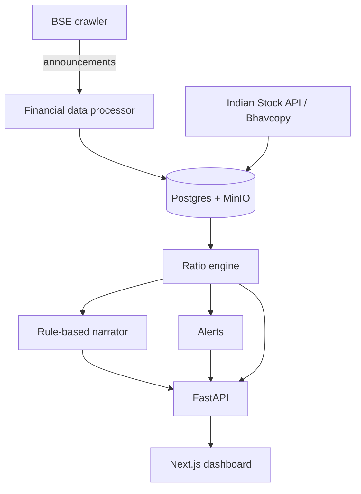

# Repository structure

What each top-level folder holds, and the module map. Back to the [README](../../README.md).

```
api/              FastAPI app (api/app.py) and security helpers (api/security.py)
alerts/           watchlist storage, flip engine, email notifier
config/           environment helpers and logging config
crawler/          BSE announcements fetcher (NSE fetcher exists, unused)
database/         schema.sql, database manager, dated migrations/
Documentations/   charter PDF and planning notes
docs/             handover, decisions, architecture, threat and failure notes
etl/              financial data processor and MinIO client
halallens-mobile/ Flutter platform scaffold (no Dart source)
jobs/             ingestion, evaluation and scheduler entry points
market_data/      Indian Stock API and Bhavcopy resolution
monitoring/       ops notifier and metrics
narrator/         rule-based narrator and optional best-effort LLM narrator
ratio_engine/     ratio math, verdict, summary, amount coercion
scripts/          run_migrations.sh and helpers
tests/            pytest suite
tools/            preflight, probes, metrics inspector, load test
ui/               Next.js 16 dashboard (static export) and jest tests
```

## Module map



Deeper maps: [`docs/ARCHITECTURE.md`](../ARCHITECTURE.md), [`docs/FLOW.md`](../FLOW.md), [`Documentations/dependency-map.md`](../../Documentations/dependency-map.md).
